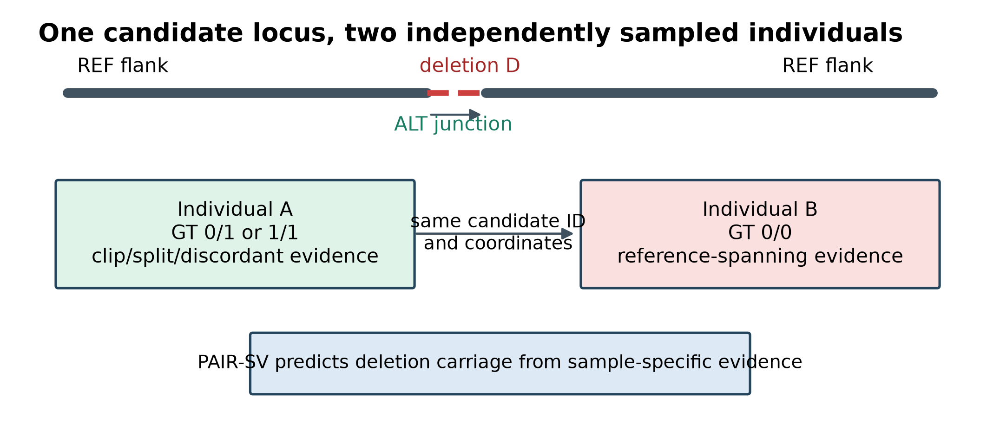
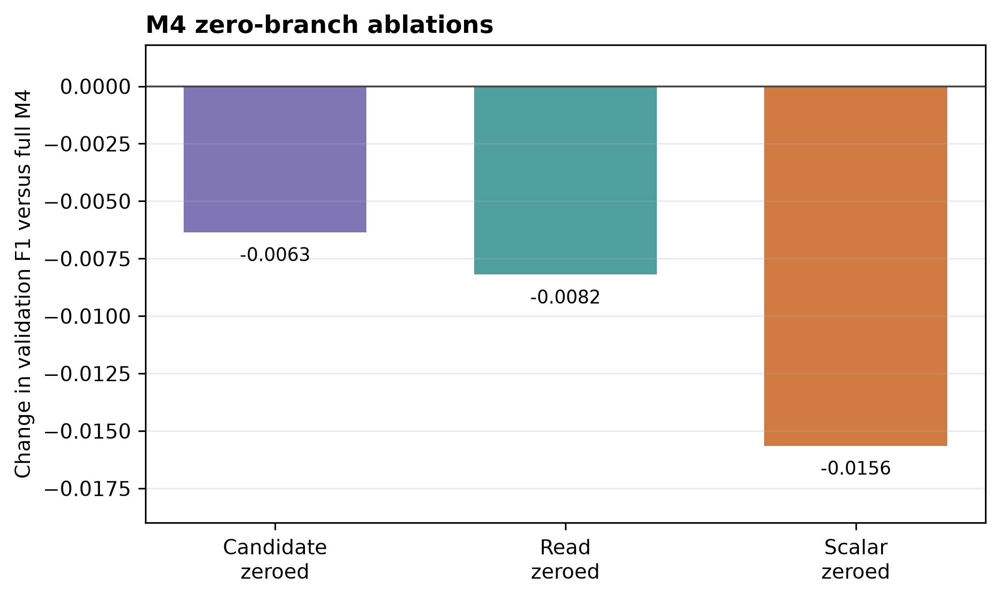

# PAIR-SV: Multimodal Detection of Genomic Deletions from Paired Breakpoint Pileups and Sample-Specific Read Evidence

## An interim multisample validation study

**Author placeholders** — Affiliation placeholder

### Structured abstract

**Background.** Short-read deletion evidence is distributed across two breakpoints and several read signals. Image classifiers can learn pileup patterns, but do not necessarily represent a candidate allele or individual read sequence.

**Methods.** PAIR-SV treats an observation as an individual-candidate deletion pair. It combines left and right pileups, candidate REF/ALT sequence embeddings, selected sample-specific read embeddings, and 17 scalar support features. Same-site negatives use the identical candidate locus in another individual with confident 0/0 genotype. This controlled interim experiment used 15 training individuals and five validation individuals (29,924 and 9,981 successful examples).

**Results.** Controlled M0, M2 and M4 achieved F1 0.7991, 0.7980 and 0.8062, respectively. A row-level paired bootstrap estimated M4-M0 F1 +0.0070 (95% CI +0.0016 to +0.0124) and M4-M2 +0.0081 (+0.0029 to +0.0138). Zero ablation reduced M4 performance for every added branch.

**Conclusions.** This is preliminary validation evidence of a small multimodal benefit. Full 40-person training, three seeds, cluster-aware uncertainty, and one untouched internal-test evaluation remain required.

**Keywords:** structural variation; genomic deletion; short-read sequencing; pileup image; multimodal learning; same-site negative.

## Introduction

Genomic deletions remove a segment relative to a reference genome. Events longer than 50 base pairs are commonly treated as structural variants and can affect genes and regulatory sequence. Short reads provide three familiar deletion signals: reduced depth within the deletion, clipped or split reads near its boundaries, and discordant read pairs with unexpected separation. No one signal is complete. A deletion has two breakpoints, so a single pileup window may omit important evidence.

DeepSV demonstrated that read-alignment images can support deletion classification [1]. PAIR-SV begins with this idea but encodes both breakpoints with shared CNN weights. It also represents the candidate reference allele and hypothetical deletion junction, reads from the individual being genotyped, and scalar support summaries. The task is candidate classification, not end-to-end discovery. We use same-site negatives: a candidate deletion is positive in one individual and 0/0 at the same locus in another. This reduces the value of locus memorization, although it cannot remove every locus-related shortcut.

## Related work

DeepSV converts aligned reads into image-like representations and applies a convolutional classifier to deletion candidates [1]. This framing exposes local alignment patterns, but a single rendered window does not explicitly distinguish the two breakpoints or encode a hypothesized alternate junction. DeepVariant similarly established that learned representations of aligned reads can be effective for a different, small-variant task [2]. PAIR-SV borrows the representation-learning motivation, while keeping its claim deliberately narrower: it classifies preselected, sequence-resolved deletion candidates rather than discovering variants genome-wide.

Conventional short-read callers integrate complementary evidence. DELLY combines discordant paired-end and split-read signals to refine breakpoints [8]; LUMPY provides a probabilistic framework for read-pair, split-read, read-depth and prior evidence [9]. Such methods are important conceptual baselines, but their discovery targets, callability rules and reported benchmarks are not interchangeable with this candidate-classification experiment. Recent deep-learning work also includes SVHunter, a long-read CNN/Transformer caller that learns local and long-range SV signatures [10]. Its sequencing technology and discovery workflow differ from PAIR-SV, so it is cited as related representation learning rather than a directly comparable competitor. Reviews describe why read length, breakpoint complexity, repeats and caller assumptions make cross-study SV comparisons difficult [11].

PAIR-SV uses high-coverage 1000 Genomes GRCh38 alignments [7], HGSVC2/PanGenie-derived silver labels [3,4], and frozen HyenaDNA sequence encoders [5]. Its distinctive supervision is multisample and same-site: the identical candidate locus can be positive in one person and confident 0/0 in another. The candidate REF/ALT representation is thus held constant in a matched locus comparison, while read evidence remains person-specific. This design does not prove locus leakage impossible, but it is stricter than random genomic negatives for this candidate-genotyping question. GIAB remains a planned future evaluation resource [6]. No numerical superiority claim over these methods is made here.

## Materials and methods

### Dataset, labels, and extraction

The planned person split is 40 train, five validation and five internal-test people. This report uses only 15 training people and all five validation people. Positives are sequence-resolved 50-10,000 bp deletions with non-missing 0/1 or 1/1 genotype and GQ >=20. Negatives are callable, conflict-free, non-missing 0/0 genotypes. Coordinates are checked on GRCh38. Positives are stratified by chromosome, length and allele frequency; negatives are matched where possible. PanGenie is a silver-standard training label source, not a GIAB-equivalent benchmark.

Each successful example contains two `(6,64,128)` uint8 pileups, selected read tokens and masks, 17 scalars, and deduplicated candidate REF/ALT context. The six image channels encode base identity, base quality, mapping quality, strand, alignment state and alternate evidence. Validation extraction completed 9,981 of 10,000 rows (0.19% failure). Identity, population, split, GQ, allele frequency, negative type, source file and read-name hash are excluded from model tensors.

| Table 1. Dataset design and quality control | Value |
|---|---|
| Strict manifest | 100,000 sample-candidate rows |
| Planned person split | 40 train / 5 validation / 5 internal test |
| Controlled snapshot | 15 train / 5 validation people; 29,924 / 9,981 successful rows |
| Class balance | 50.0% positive / 50.0% negative in planned validation rows |
| Validation extraction failure | 19/10,000 (0.19%) |
| Leakage probes | metadata ROC-AUC 0.57484; train-locus prior to validation AUC 0.53066 |
| Labels | PanGenie/HGSVC2 silver; callable conflict-free same-site 0/0 negatives |
| Candidate / read embedding | five × 256-dimensional (1,280 total) / 768-dimensional pooled |
| Model scalars | 17; sample, population, GQ, AF, type, file and split excluded |
| Internal-test access | none |

### Architecture and variants

The tied image encoder produces left and right image features, their absolute difference and product. Candidate context uses 1,024-bp REF and ALT sequences. A frozen HyenaDNA encoder provides REF, ALT, ALT-REF, absolute difference and junction embeddings, each 256-dimensional. Up to 48 selected reads per breakpoint are tokenized to 128 bases, encoded by a frozen model and pooled with masks to 768 dimensions. Scalars summarize clipping and split support, discordant pairs, depth, mapping and base quality, insert-size anomaly, breakpoint balance and log deletion length. Residual late fusion adds multimodal information while preserving the image path at initialization.

| Table 2. Controlled model variants | Images | REF/ALT | Reads | Scalars | Parameters |
|---|:---:|:---:|:---:|:---:|---:|
| M0 | yes | no | no | no | 287,618 |
| M2 | yes | no | no | yes | 323,110 |
| M4 | yes | yes | yes | yes | 622,374 |

All variants used seed 20260720, five epochs, AdamW (learning rate 2 × 10^-4, weight decay 10^-4), batch size 16, mixed precision and cross-entropy loss. Normalization was fit on training people only. The best checkpoint and threshold were selected using validation F1. The result is therefore model-selection evidence, not an unbiased test estimate.

## Results

M0 was a strong paired-breakpoint baseline. M2 did not improve M0 in this controlled realization. M4 had the highest F1, ROC-AUC, PR-AUC and MCC. The effect is modest, not a claim of broad generalization. The following display uses literal successful validation rows from the required QC categories; the cyan line marks the breakpoint.

| Table 3. Controlled validation results from identical row-aligned predictions | Loss | Precision | Recall | F1 | ROC-AUC | PR-AUC | MCC | Threshold | TN/FP/FN/TP | Time (s) |
|---|---:|---:|---:|---:|---:|---:|---:|---:|---|---:|
| M0 | .4261 | .7609 | .8413 | .7991 | .8836 | .8947 | .5807 | .415 | 3678/1318/791/4194 | 1065 |
| M2 | .4242 | .7591 | .8411 | .7980 | .8844 | .8954 | .5780 | .445 | 3665/1331/792/4193 | 1025 |
| M4 | .4102 | .7668 | .8497 | .8062 | .8914 | .9003 | .5954 | .435 | 3708/1288/749/4236 | 1044 |

The paired row-bootstrap used 1,000 paired resamples of aligned sample-candidate rows. It supports a small M4 advantage over M0 and M2, while M2-M0 includes zero. Because candidates can recur across people, this row bootstrap does not fully model candidate-locus dependence; candidate-cluster bootstrap remains final-paper work.

| Table 4. Paired row-bootstrap | ΔF1 | 95% CI | Interpretation |
|---|---:|---|---|
| M4-M0 | +.0070 | [.0016, .0124] | small support |
| M4-M2 | +.0081 | [.0029, .0138] | small support |
| M2-M0 | -.0010 | [-.0050, .0034] | inconclusive |

## Branch ablations and subgroup analysis

Zeroing candidate, read or scalar branches changed predictions and reduced M4 F1 by .0063, .0082 and .0156. This demonstrates functional dependence on each branch, but zeroing is out of distribution and is not causal proof. Shuffle interventions were unstable and are reported in the supplement only. The largest drop followed scalar removal, while M2 alone did not improve M0; this is consistent with multimodal interaction but does not prove synergy. Length, genotype, negative-type and per-person metrics are supplied in the accompanying subgroup CSV and supplement.

## Discussion and limitations

PAIR-SV jointly represents two breakpoint windows, an allele hypothesis and individual read evidence. On this one-seed controlled validation, M4 provides a small improvement over M0 and M2. Important limitations are 15 training people, validation threshold selection, row-level rather than candidate-cluster bootstrap, silver labels, pairability filtering, residual locus effects, candidate classification rather than discovery, deletion-only scope, frozen encoders, and unstable shuffles. Results cannot be compared numerically with DeepSV because datasets and protocols differ.

## Conclusion

The controlled Train15 experiment supports continued evaluation of multimodal deletion classification. Final claims require full 40-person training, three seeds, cluster-aware uncertainty and one evaluation of the untouched five-person internal-test cohort.

## Data and code availability

Controlled artifacts, checksums and source tables are retained in the PAIR-SV repository. Internal-test results are absent from this manuscript.

## References

1. Cai L. et al. *DeepSV: accurate calling of genomic deletions from high-throughput sequencing data using deep convolutional neural network.* BMC Bioinformatics. 2019;20:665. doi:10.1186/s12859-019-3299-y.
2. Poplin R. et al. *A universal SNP and small-indel variant caller using deep neural networks.* Nature Biotechnology. 2018;36:983-987. doi:10.1038/nbt.4235.
3. Ebert P. et al. *Haplotype-resolved diverse human genomes and integrated analysis of structural variation.* Science. 2021;372:eabf7117. doi:10.1126/science.abf7117.
4. Ebler J. et al. *Pangenome-based genome inference allows efficient and accurate genotyping across a wide spectrum of variant classes.* Nature Genetics. 2022;54:518-525. doi:10.1038/s41588-022-01043-w.
5. Nguyen E. et al. *HyenaDNA: long-range genomic sequence modeling at single nucleotide resolution.* NeurIPS. 2023.
6. Zook JM. et al. *A robust benchmark for detection of germline large deletions and insertions.* Nature Biotechnology. 2020;38:1347-1355. doi:10.1038/s41587-020-0538-8.
7. Byrska-Bishop M. et al. *High-coverage whole-genome sequencing of the expanded 1000 Genomes Project cohort including 602 trios.* Cell. 2022;185:3426-3440.e19. doi:10.1016/j.cell.2022.08.004.
8. Rausch T. et al. *DELLY: structural variant discovery by integrated paired-end and split-read analysis.* Bioinformatics. 2012;28:i333-i339. doi:10.1093/bioinformatics/bts378.
9. Layer RM, Chiang C, Quinlan AR, Hall IM. *LUMPY: a probabilistic framework for structural variant discovery.* Genome Biology. 2014;15:R84. doi:10.1186/gb-2014-15-6-r84.
10. Gao R. et al. *SVHunter: long-read-based structural variation detection through the transformer model.* Briefings in Bioinformatics. 2025;26:bbaf203. doi:10.1093/bib/bbaf203.
11. Mahmoud M. et al. *Structural variant calling: the long and the short of it.* Genome Biology. 2019;20:246. doi:10.1186/s13059-019-1828-7.
