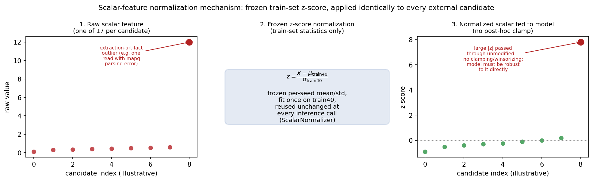

# Проверка классификатора делеций на 30 геномах: результат, полученный на одном человеке, не воспроизвёлся

*Русская версия статьи. Английский оригинал для научной подачи —
`paper/PAIR_SV_v1_manuscript.md`; все числа в обоих текстах совпадают и
взяты из одних и тех же замороженных файлов с результатами.*

---

## 1. Краткое изложение

Программы, отсеивающие ложные находки структурных изменений ДНК, обычно
проверяют на одном хорошо изученном геноме. За этим стоит допущение, что
результат, полученный на одном человеке, описывает поведение программы у
людей вообще. Мы проверили это допущение на собственной разработке.

PAIR-SV перепроверяет кандидатов на делецию — потерю участка ДНК, — которых
предложил детектор Manta. Программа оценивает кандидата по изображению
прочтений ДНК вокруг обеих точек разрыва, а в более сложных версиях
добавляет к этому последовательность ДНК в месте предполагаемой делеции
(через готовую языковую модель генома), отдельные прочтения и 17 числовых
признаков качества данных. Пять вложенных версий (M0–M4) используют общую
основу и различаются только тем, какие дополнительные источники данных
подключены. Обучение построено на парах по одному и тому же участку генома
у 40 человек: каждый участок даёт положительный пример у носителя делеции и
отрицательный — у другого человека с надёжно подтверждённым отсутствием
делеции в том же месте.

Мы проверяли программу на четырёх уровнях, ни разу их не смешивая:
контролируемый тест на подготовленных парах; исследование на 5 людях с
реальным выводом Manta, где был подобран порог отсечения с целью 95%
чувствительности; один нетронутый геном (HG002); и нетронутая группа из 30
человек по шесть представителей каждой из пяти континентальных групп
происхождения, проверенных на отсутствие родства со всеми предыдущими
выборками. Последние два уровня открывались ровно один раз, с заранее
зафиксированными и контрольно захэшированными порогами, определениями
метрик, определениями подгрупп и составом выборки.

На группе из 30 человек чувствительность при замороженном пороге, усреднённая
по людям, составила 0,9453 (M0), 0,9473 (M2) и 0,9471 (M4); специфичность —
0,2167, 0,2216 и 0,2253. **Ни одна из трёх версий не достигла заранее
заявленной цели в 95% чувствительности.** Недобор небольшой и одинаковый у
разных людей: стандартное отклонение между людьми — около 0,006, все 30
человек укладываются в диапазон от 0,928 до 0,962. Все три версии получили
более низкую сводную метрику F1, чем правило «принять всех кандидатов
Manta» (0,9223–0,9238 против 0,9378); это следствие того, что 88,3%
кандидатов и так верны, и именно поэтому F1 не используется здесь как
главная метрика.

На HG002 версия M2 была единственной, превысившей цель в 95% (0,9551), а M4
не дотянула 1,7 процентных пункта (0,9327). Мы прочитали это как различие
между версиями программы. **На группе из 30 человек это различие не
сохранилось:** M2 и M4 различаются там по усреднённой чувствительности на
0,000176 — примерно в тридцать пять раз меньше, чем стандартное отклонение
между людьми. Порядок, наблюдавшийся на HG002, отражал особенности набора
кандидатов именно у этого человека. M4 имела самую высокую специфичность во
всех трёх внешних проверках; мы не планировали заранее статистический тест
для этого различия и не заявляем о его значимости, а M4 остаётся основной
версией по заранее принятому решению, а не по этим результатам.

Главный вклад работы, таким образом, относится к методике оценки, а не к
сравнению версий программы: замороженной проверки на одном геноме хватило,
чтобы обосновать вывод, который не воспроизвели тридцать геномов. Параллельное
сравнение в том же исследовании показывает, что быстрый способ оценки вклада
источников данных (обнуление входа у готовой модели) завышает вклад каждого
источника в 5–10 раз по сравнению с переобучением модели без этого источника.

Два обстоятельства ограничивают область применимости выводов. Специфичность
для шести человек африканского происхождения составила 0,174–0,183 против
0,223–0,243 у остальных четырёх групп; это согласуется с эффектом
представленности популяций в панели генотипирования, поставляющей эталонные
ответы, но причинную связь анализ не устанавливает. Кроме того, замороженный
порог, хотя и переносится между людьми одинаково, находится ниже той
чувствительности, на которую его настраивали. PAIR-SV перепроверяет
кандидатов, уже предложенных детектором, и не находит делеции, которые
детектор пропустил; о клинической или промышленной пригодности мы никаких
утверждений не делаем.

---

## 2. Введение

Поиск структурных изменений ДНК по коротким прочтениям полного генома на
практике остаётся двухэтапной задачей. Сначала детектор — например, Manta
[chen2016manta] — по косвенным признакам в данных секвенирования предлагает
места возможных разрывов. Затем второй этап (ручная проверка специалистом,
жёсткие пороги отсечения или эвристики по частоте варианта в популяции)
решает, каким кандидатам верить. Делеции изучены для этой задачи лучше всех
прочих типов структурных изменений, но детекторы по-прежнему предлагают
избыточно много: заметная доля кандидатов, прошедших внутренний фильтр
Manta, не соответствует настоящему варианту в указанном месте, и эта доля
меняется в зависимости от длины делеции, сложности точек разрыва и
особенностей окружающей последовательности ДНК.

Этап перепроверки кандидатов принципиально отличается от этапа *поиска*, и
эти два этапа часто смешивают. Классификатор, успешно отбраковывающий
ложных кандидатов, не может вернуть настоящие делеции, которые детектор
вообще не предложил. Статья, сообщающая качество классификатора без
разделения этих двух вопросов, рискует преувеличить то, что на самом деле
показано.

За первым вопросом стоит второй, и в итоге статья оказалась именно о нём.
Программы такого рода принято проверять на одном хорошо изученном геноме —
чаще всего это HG002 из коллекции Genome in a Bottle. За этой практикой
стоит допущение, что вывод, сделанный на одном внешнем геноме, описывает
поведение программы у людей вообще. Мы проверили собственную программу этим
способом, а затем проверили само допущение, повторив оценку на тридцати
нетронутых людях. Допущение не подтвердилось.

PAIR-SV — классификатор, предназначенный именно для этапа перепроверки. Он
принимает на вход кандидата на делецию от Manta (хромосома, координаты
точек разрыва, предполагаемый генотип) вместе с выровненными прочтениями
конкретного человека и выдаёт вероятность того, что у этого человека в этом
месте действительно есть делеция. Программа устроена как лестница из пяти
версий (M0–M4, §6), последовательно добавляющих источники данных: M0
использует только изображение прочтений вокруг двух точек разрыва; M1
добавляет последовательность ДНК в месте кандидата (эталонный и
предполагаемый изменённый вариант) через готовую языковую модель генома
HyenaDNA; M2 добавляет семнадцать числовых признаков поддержки прочтениями;
M3 добавляет представления отдельных прочтений; M4 объединяет все три
дополнительные ветви поверх общей основы. Лестница обучается на парной
разметке по одному участку (§5): один и тот же участок генома служит
положительным примером у человека, несущего делецию, и надёжно размеченным
отрицательным примером у другого человека, у которого делеции нет. Внутри
пары окружающая последовательность ДНК одинакова, различаются только данные
прочтений конкретного человека. Такая схема требует обучающих данных сразу
по нескольким людям; в §3 описаны предшествующие работы, также обучающиеся
на примерах по одному участку у разных людей.

Статья сообщает четыре уровня доказательств — от наиболее контролируемых к
наиболее приближённым к реальности — того, даёт ли эта архитектура, и в
особенности данные, добавленные сверх базовой версии M0, измеримое и
*переносимое* улучшение:

1. **Полностью контролируемый отложенный внутренний тест** (§9.2) на
   подготовленных парах кандидатов по одному участку у 5 человек, никогда не
   использовавшихся при обучении или отборе модели, но взятых из той же
   выборки в 50 человек. Этот уровень отделяет качество архитектуры от любых
   вопросов о смене распределения данных.
2. **Развёрточное исследование на реальных кандидатах** у 5 других людей
   (§11–12). Оно показывает, как модели, обученные на подготовленных парах,
   ведут себя на настоящем, неотфильтрованном и сильно несбалансированном
   потоке кандидатов Manta, и служит для разработки и проверки процедуры
   подбора порога (поочерёдное исключение людей, цель — около 95%
   чувствительности) до того, как будут открыты какие-либо нетронутые данные.
3. **Один нетронутый внешний человек, HG002** (§13–14), проверенный ровно
   один раз против независимого эталона, построенного по полной пересборке
   генома (GIAB v5.0q), с применением процедуры из пункта 2 без изменений.
   Это первая проверка на данных, не участвовавших в разработке.
4. **Нетронутая внешняя группа из 30 человек** (§15.12), сбалансированная по
   пяти континентальным группам происхождения, проверенная ровно один раз.
   Задача — выяснить, обобщается ли результат, полученный на одном человеке,
   на людей разного происхождения, или он отражает свойства набора вариантов
   у одного конкретного человека. Оказалось второе: порядок версий по
   чувствительности, наблюдавшийся на HG002, на 30 людях не воспроизводится
   (§15.12).

M4 не имеет устойчивого преимущества над более простыми версиями. На
внутреннем тесте она статистически неотличима от M2 (§9.2). На 5 людях
развёрточного исследования все три версии укладываются в диапазон
специфичности 0,212–0,240 при рабочей точке 95% чувствительности (§12). На
HG002 у M4 была самая высокая специфичность из трёх и чувствительность на
1,7 пункта ниже цели в 95%, которой M2 достигла; на 30 людях этот порядок по
чувствительности не сохраняется (§15.12).

**Что даёт эта работа.**

- Мы показываем на собственном, заранее зарегистрированном результате, что
  внешняя проверка на одном геноме способна обосновать вывод об устройстве
  модели, который не воспроизводится на выборке людей. На HG002 только M2
  достигла заранее заявленной цели в 95% чувствительности, а M4 не дотянула
  1,7 пункта. На 30 нетронутых людях этот порядок не сохраняется (§15.12).
- Мы описываем замороженный, захэшированный протокол однократной оценки на
  восьми раздельных уровнях доказательности, где пороги, определения метрик,
  определения подгрупп и состав выборки фиксируются до открытия любых
  эталонных ответов. Полученную рабочую точку мы сообщаем как промах: ни одна
  из трёх версий не достигла цели в 95% чувствительности на группе из 30
  человек.
- Мы измеряем второй артефакт оценки в том же исследовании: обнуление входа
  у готовой модели завышает вклад каждого источника данных в 5–10 раз по
  сравнению с переобучением модели без этой ветви.
- Мы описываем архитектуру перепроверки кандидатов и намеренно построенную
  сбалансированную схему парной разметки по одному участку вместе с
  количественными проверками остаточных обходных путей на уровне участка
  генома. Сама по себе разметка по одному участку у разных людей не нова
  (§3); новое здесь — явное построение такой схемы и измерение обходных
  путей.

---

## 3. Предшествующие работы

**Детекторы структурных вариантов.** Manta [chen2016manta], DELLY
[rausch2012delly], LUMPY [layer2014lumpy] и детекторы для длинных прочтений
(Sniffles [sedlazeck2018sniffles], pbsv [software-ref]) представляют первый
этап двухэтапной схемы, ниже которого расположен классификатор из этой
статьи. Мы не предлагаем нового детектора и не сравниваем PAIR-SV с DELLY
или другими детекторами как с альтернативными источниками кандидатов.
PAIR-SV оценивается исключительно как фильтр собственных кандидатов Manta, и
любое утверждение о его качестве следует читать как обусловленное полнотой
поиска у самой Manta, а не как самостоятельную меру полноты обнаружения
делеций. Конкретное воплощение этого разграничения — §13, где полнота поиска
самой Manta отделена от качества фильтрации PAIR-SV.

**Обучаемое генотипирование и фильтрация структурных вариантов.** Ближе всего
к этой работе стоят два метода. DeepSVFilter [liu2021deepsvfilter] фильтрует
кандидатов детектора по коротким прочтениям с помощью свёрточной сети,
работающей с трёхканальным изображением: глубина прочтения, несогласованные
пары, разорванные прочтения. Положительными примерами там служат вызовы,
пересекающиеся с эталонным набором, отрицательными — отсутствующие в нём,
поэтому положительные и отрицательные примеры находятся в разных, не
связанных между собой местах генома; модель для делеций обучалась на HG002.
Samplot-ML [belyeu2021samplot] классифицирует предполагаемые делеции по
изображениям Samplot сетью типа ResNet, а метки классов генотипа (0/0, 0/1,
1/1) берёт из сводной карты структурных вариантов третьей фазы проекта
«1000 геномов» [sudmant2015sv] по многим людям. Поскольку метод
генотипирует каталогизированные участки у многих людей, один и тот же
участок несёт разные метки у разных людей; авторы описывают это как
следствие самой постановки задачи генотипирования, исключают прямых
родственников тестовых людей и отмечают, что часть участков всё же попадает
и в обучение, и в тест. Cue [popic2023cue] переводит выравнивания в
изображения и предсказывает тип варианта, генотип и положение, но ищет
структурные варианты, а не перепроверяет кандидатов отдельного детектора,
поэтому решает другую задачу. CSV-Filter [xia2024csvfilter] решает ту же
задачу фильтрации и для коротких, и для длинных прочтений, кодируя строки
CIGAR как полутоновые изображения и классифицируя их парой сетей ResNet-50,
предобученных без учителя. Положительные примеры взяты из набора
высоконадёжных вызовов GIAB HG002, отрицательные генерируются синтетически
по распределению длин, поэтому положительные и отрицательные примеры снова
находятся в не связанных между собой местах генома; и обучение, и внутреннее
тестирование используют HG002.

**Мы не утверждаем, что разметка по одному участку у разных людей нова.**
Samplot-ML уже обучается на примерах, размеченных по одному участку
по-разному у разных людей. PAIR-SV добавляет к этой линии работ более узкое:
(а) парное сопоставление построено намеренно и сбалансировано по замыслу —
каждый участок даёт одну положительную строку у носителя и одну строку с
надёжно определённым отсутствием делеции у другого человека, с проверкой по
качеству генотипа, доступности участка для анализа и исключению
противоречий, — а остаточные обходные пути на уровне участка затем
измеряются напрямую, а не предполагаются отсутствующими (§8); и (б)
лестница версий, выделяющая вклад каждого добавленного типа данных при двух
разных способах проверки — обнулением входа и переобучением. Нам неизвестны
предшествующие работы по структурным вариантам, где обходной путь через
запоминание участка измерялся бы таким образом, хотя мы не просматривали
область исчерпывающе.

**Языковые модели геномных последовательностей.** HyenaDNA
[nguyen2023hyenadna] и близкие модели длинного контекста используются здесь
исключительно как готовый, неизменяемый извлекатель признаков для
последовательности ДНК в месте кандидата (M1/M4) и для последовательностей
прочтений (M3/M4). Мы не дообучаем HyenaDNA и не делаем никаких утверждений
о превосходстве той или иной архитектуры языковых моделей: представление
последовательности рассматривается как один источник данных среди
нескольких, а его вклад измеряется опытным путём (§10) и оказывается
скромным и в значительной степени дублирующим ветвь числовых признаков.

**Практика сравнения с эталонами GIAB.** Эталонные наборы HG002 от
консорциума Genome in a Bottle — устоявшийся набор NIST SV v0.6
[zook2020giabsv] для сборки генома GRCh37 и более новый v5.0q для GRCh38,
построенный по полной пересборке генома [giab-v5.0q-release] — широко
используются для сравнения детекторов структурных вариантов; сопоставление в
этой статье выполняется программой Truvari [english2022truvari]. Мы
используем v5.0q как основной внешний эталон, потому что он изначально
построен для GRCh38 (той же сборки, что и все остальные этапы нашего
конвейера, — это избавляет от шага переноса координат) и потому что два
эталона построены по-разному: v5.0q получен программой dipcall из
пересобранного диплоидного генома, тогда как v0.6 собран как согласованное
мнение нескольких детекторов, работающих по прочтениям. Мы не считаем ни
один из двух способов построения более точным. Статья прямо отмечает
черновой, ещё не прошедший рецензирование статус v5.0q (§13, §16) и приводит
устоявшийся v0.6 как отдельную, никогда не объединяемую с основной проверку
чувствительности выводов (§13) именно потому, что у двух наборов разные,
невзаимозаменяемые ограничения (v5.0q — черновой и менее проверенный на
практике; v0.6 — только для GRCh37, с заявленным охватом не более 50%
структурных вариантов генома и со смещением в сторону более простых
вариантов).

---

## Проверенные источники

Каждая запись ниже сверена с карточкой в PubMed или у издателя. Неразрешённых
ссылок-заглушек в этом разделе не осталось.

- **[chen2016manta]** Chen X, Schulz-Trieglaff O, Shaw R, Barnes B,
  Schlesinger F, Källberg M, Cox AJ, Kruglyak S, Saunders CT. Manta: rapid
  detection of structural variants and indels for germline and cancer
  sequencing applications. *Bioinformatics.* 2016;32(8):1220-2.
  doi:10.1093/bioinformatics/btv710. PMID: 26647377
- **[english2022truvari]** English AC, Menon VK, Gibbs RA, Metcalf GA,
  Sedlazeck FJ. Truvari: refined structural variant comparison preserves
  allelic diversity. *Genome Biology.* 2022;23:271.
  doi:10.1186/s13059-022-02840-6. PMID: 36575487
- **[nguyen2023hyenadna]** Nguyen E, Poli M, Faizi M, Thomas A, Wornow M,
  Birch-Sykes C, Massaroli S, Patel A, Rabideau C, Bengio Y, Ermon S, Ré C,
  Baccus S. HyenaDNA: long-range genomic sequence modeling at single
  nucleotide resolution. *Advances in Neural Information Processing Systems
  36* (NeurIPS 2023):43177-43201
- **[zook2020giabsv]** Zook JM, Hansen NF, Olson ND, Chapman L, Mullikin JC,
  Xiao C, Sherry S, Koren S, Phillippy AM, Boutros PC, Sahraeian SME, Huang
  V, Rouette A, Alexander N, Mason CE, Hajirasouliha I, Ricketts C, Lee J,
  Tearle R, Fiddes IT, Martinez Barrio A, Wala J, Carroll A, Ghaffari N,
  Rodriguez OL, Bashir A, Jackman S, Farrell JJ, Wenger AM, Alkan C, Soylev
  A, Schatz MC, Garg S, Church G, Marschall T, Chen K, Fan X, English AC,
  Rosenfeld JA, Zhou W, Mills RE, Sage JM, Davis JR, Kaiser MD, Oliver JS,
  Catalano AP, Chaisson MJP, Spies N, Sedlazeck FJ, Salit M. A robust
  benchmark for detection of germline large deletions and insertions.
  *Nature Biotechnology.* 2020;38(11):1347-1355.
  doi:10.1038/s41587-020-0538-8. PMID: 32541955
- **[liu2021deepsvfilter]** Liu Y, Huang Y, Wang G, Wang Y. A deep learning
  approach for filtering structural variants in short read sequencing data.
  *Briefings in Bioinformatics.* 2021;22(4):bbaa370. doi:10.1093/bib/bbaa370.
  PMID: 33378767
- **[belyeu2021samplot]** Belyeu JR, Chowdhury M, Brown J, Pedersen BS,
  Cormier MJ, Quinlan AR, Layer RM. Samplot: a platform for structural
  variant visual validation and automated filtering. *Genome Biology.*
  2021;22:161. doi:10.1186/s13059-021-02380-5. PMID: 34034781
- **[popic2023cue]** Popic V, Rohlicek C, Cunial F, et al. Cue: a
  deep-learning framework for structural variant discovery and genotyping.
  *Nature Methods.* 2023;20:559-568. doi:10.1038/s41592-023-01799-x
- **[xia2024csvfilter]** Xia Z, Xiang W, Wang Q, Li X, Li Y, Gao J, Tang T,
  Yang C, Cui Y. CSV-Filter: a deep learning-based comprehensive structural
  variant filtering method for both short and long reads. *Bioinformatics.*
  2024;40(9):btae539. doi:10.1093/bioinformatics/btae539
- **[ebert2021]** Ebert P, Audano PA, Zhu Q, Rodriguez-Martin B, Porubsky D,
  et al. Haplotype-resolved diverse human genomes and integrated analysis of
  structural variation. *Science.* 2021;372(6537):eabf7117.
  doi:10.1126/science.abf7117. PMID: 33632895
- **[rausch2012delly]** Rausch T, Zichner T, Schlattl A, Stütz AM, Benes V,
  Korbel JO. DELLY: structural variant discovery by integrated paired-end and
  split-read analysis. *Bioinformatics.* 2012;28(18):i333-i339.
  doi:10.1093/bioinformatics/bts378. PMID: 22962449
- **[layer2014lumpy]** Layer RM, Chiang C, Quinlan AR, Hall IM. LUMPY: a
  probabilistic framework for structural variant discovery. *Genome Biology.*
  2014;15(6):R84. doi:10.1186/gb-2014-15-6-r84. PMID: 24970577
- **[sedlazeck2018sniffles]** Sedlazeck FJ, Rescheneder P, Smolka M, Fang H,
  Nattestad M, von Haeseler A, Schatz MC. Accurate detection of complex
  structural variations using single-molecule sequencing. *Nature Methods.*
  2018;15(6):461-468. doi:10.1038/s41592-018-0001-7. PMID: 29713083
- **[byrska-bishop2022]** Byrska-Bishop M, Evani US, Zhao X, Basile AO, Abel
  HJ, Regier AA, Corvelo A, Clarke WE, Musunuri R, Nagulapalli K, Fairley S,
  Runnels A, Winterkorn L, Lowy E, Flicek P, Germer S, Brand H, Hall IM,
  Talkowski ME, Narzisi G, Zody MC. High-coverage whole-genome sequencing of
  the expanded 1000 Genomes Project cohort including 602 trios. *Cell.*
  2022;185(18):3426-3440.e19. doi:10.1016/j.cell.2022.08.004. PMID: 36055201
- **[sudmant2015sv]** Sudmant PH, Rausch T, Gardner EJ, Handsaker RE, Abyzov
  A, Huddleston J, Zhang Y, Ye K, et al.; 1000 Genomes Project Consortium. An
  integrated map of structural variation in 2,504 human genomes. *Nature.*
  2015;526(7571):75-81. doi:10.1038/nature15394. PMID: 26432246
- **[ebler2022]** Ebler J, Ebert P, Clarke WE, Rausch T, Audano PA, Houwaart
  T, Mao Y, Korbel JO, Eichler EE, Zody MC, Dilthey AT, Marschall T.
  Pangenome-based genome inference allows efficient and accurate genotyping
  across a wide spectrum of variant classes. *Nature Genetics.*
  2022;54(4):518-525. doi:10.1038/s41588-022-01043-w. PMID: 35410384

**Источники, не являющиеся статьями.** `[giab-v5.0q-release]` — это выпуск
данных NIST, а не рецензируемая публикация, и его следует цитировать с
указанием версии и даты обращения; аргумент о черновом статусе в §15.10
опирается на это различие. `[software-ref]` обозначает pbsv, для которого не
найдено первичной публикации; его следует цитировать как программное
обеспечение.

**Осталось неразрешённым.** Для smoove первичной публикации найти не
удалось, поэтому упоминание убрано из перечня детекторов, а не приписано
статье про LUMPY. Цифра «не более 50% охвата структурных вариантов генома» в
этом разделе взята из файла с описанием выпуска v0.6, а не из
[zook2020giabsv]; для неё нужна ссылка на уровне выпуска данных того же
типа, что и `[giab-v5.0q-release]`, и эта ссылка пока не добавлена. Источник
`byrska-bishop2022` цитируется в §4, и его запись выше полна, за исключением
полного списка авторов.

---

## 4. Контролируемый набор данных по многим людям

Кандидаты на делецию и парные к ним отрицательные примеры по тому же участку
взяты у 50 неродственных людей, секвенированных с высокой глубиной (30-кратное
покрытие) в расширенном наборе выравниваний проекта «1000 геномов»
[byrska-bishop2022] для сборки генома GRCh38. Эталонные метки генотипов
среднего уровня надёжности взяты из ресурса генотипирования по пангеному
HGSVC2, построенного программой PanGenie [ebert2021, ebler2022] (файл
`pangenie_merged_bi_nosnvs.vcf.gz`, 3202 образца).

50 человек были разделены по людям — до какого-либо извлечения данных — на
40 обучающих, 5 настроечных и 5 для внутреннего теста, причём ни один
человек не попадает больше чем в одну группу:

- Обучение (40): HG00096, HG00097, HG00099, HG00100, HG00101, HG00102,
  HG00103, HG00105, HG00403, HG00404, HG00406, HG00407, HG00409, HG00410,
  HG00419, HG00421, HG00551, HG00553, HG00554, HG00637, HG00638, HG00640,
  HG00641, HG00731, HG01583, HG01586, HG01589, HG01593, HG01879, HG01880,
  HG01882, HG01883, HG01885, HG01886, HG01889, HG01890, HG02490, HG02491,
  HG02493, HG02494.
- Настройка (5): HG00106, HG00422, HG00732, HG01894, HG02597.
- Внутренний тест (5, нетронутый до единственной оценки — см. §7): HG00107,
  HG00428, HG00734, HG01896, HG02600.

Из 12 272 парных кандидатов по одному участку у этих 50 человек построен
строгий перечень в 100 000 строк «человек–кандидат» (50 000 положительных и
50 000 отрицательных, точно поровну по построению). Отбор проходил по
следующим условиям: корректность структуры записи, генотипа, качества
генотипа и внутреннего фильтра; доступность участка для анализа; исключение
противоречий по генотипу; согласованность координат; целостность разделения
по людям (`multisample_progress.md`, запись R14). Положительный пример
требует непропущенного генотипа 0/1 или 1/1 с качеством не ниже 20;
отрицательный требует доступного для анализа, непротиворечивого,
непропущенного генотипа 0/0 в том же самом участке у другого человека
(см. §5). Делеции имеют разрешённую последовательность, длину от 50 до
10 000 пар оснований, находятся только на неполовых хромосомах и имеют
однозначные координаты в GRCh38.

Извлечение признаков из файлов прочтений выполнялось по частям (8 частей по
10 000 строк для обучения, одна часть в 10 000 строк для настройки, по 5
человек на часть). Извлечение удалось для 79 801 из 80 000 обучающих строк
(199 неудач, 0,25%; баланс классов в удавшемся наборе — 39 842 положительных
и 39 959 отрицательных) и для 9 981 из 10 000 настроечных строк (19 неудач,
0,19%). Извлечение для внутреннего теста (§7) удалось для 9 978 строк.
Неудачи сохраняются как отдельная учётная категория (ошибка извлечения
кандидата, преимущественно из-за отсутствия прочтений в одной или обеих
точках разрыва) и никогда не отбрасываются молча.

Каждая удавшаяся строка содержит два изображения прочтений вокруг точек
разрыва размера (6, 64, 128) в виде однобайтовых чисел, до 48 отобранных
прочтений на точку разрыва вместе с масками, 17 числовых признаков поддержки
прочтениями и очищенный от дубликатов контекст последовательности ДНК длиной
1024 пары оснований для эталонного и предполагаемого изменённого варианта.
Шесть каналов изображения кодируют: тип основания, качество прочтения
основания, качество выравнивания, цепь ДНК, состояние выравнивания и
признаки альтернативного варианта. Идентификатор человека, метка популяции,
принадлежность к группе разделения, качество генотипа, частота варианта, тип
отрицательного примера, номер исходной части и хэш имени прочтения по
построению исключены из всех входных данных модели (проверку эффективности
этого исключения см. в §8).

Снимок обучающего набора Train40 захэширован целиком: у каждой из 8
обучающих частей есть независимая контрольная сумма SHA-256, и у всего
снимка есть контрольная сумма содержимого
(`916bbcbdd54d5e34a345be2449373bef621b8cbb8e0ccfd53821b866215a1d33`, файл
`train40_snapshot.json`), вычисленная до того, как какая-либо модель увидела
данные.

| Состав набора данных | Значение |
|---|---|
| Всего людей | 50 (40 обучение / 5 настройка / 5 внутренний тест), без пересечений по людям |
| Строгий перечень | 100 000 строк «человек–кандидат», 50 000/50 000 поровну по построению, 12 272 парных кандидата по одному участку |
| Извлечение для обучения | 79 801 из 80 000 успешно (0,25% неудач); 39 842 положительных / 39 959 отрицательных |
| Извлечение для настройки | 9 981 из 10 000 успешно (0,19% неудач) |
| Извлечение для внутреннего теста | 9 978 успешно (§7) |
| Диапазон длин делеций | 50–10 000 пар оснований, с разрешённой последовательностью, неполовые хромосомы |
| Целостность снимка | контрольные суммы SHA-256 по частям и по всему снимку, вычислены до обучения |

**Рисунок 1. Схема исследования и разделение выборок.** Четыре уровня
доказательности, не пересекающиеся по людям: контролируемая выборка из 50
человек (40 обучение / 5 настройка / 5 внутренний тест), развёрточное
исследование на реальных кандидатах у 5 человек, HG002 из коллекции GIAB и
нетронутая группа из 30 человек (по 6 на каждую континентальную группу
происхождения). Состав и семейные идентификаторы проверены так, что ни один
человек и ни одна семья не встречаются больше чем на одном уровне.

---

## 5. Парная разметка по одному участку

Главное решение в устройстве набора данных состоит в том, что место
кандидата в геноме (хромосома, координаты, окружающая последовательность)
никогда не определяет его метку однозначно. Каждая пара кандидатов по одному
участку помещает один и тот же участок в перечень дважды: как положительную
строку (человек с надёжным генотипом 0/1 или 1/1 в этом месте) и как
отрицательную строку (другой человек с надёжным, доступным для анализа,
непротиворечивым генотипом 0/0 в том же самом месте). Окружающая
последовательность ДНК и представление координат внутри пары постоянны;
различаются только данные прочтений конкретного человека — два изображения
вокруг точек разрыва, отобранные прочтения и 17 числовых признаков
поддержки.

Это намеренная попытка обесценить запоминание участка как обходной путь.
Модель, выучившая только правило «в этой координате обычно бывает настоящая
делеция», не сможет различить две строки одной пары, поскольку координата у
них общая. Схема не устраняет все обходные пути, связанные с местом в геноме
(модель по-прежнему видит эталонную и предполагаемую изменённую
последовательность, которые определяются местом), — поэтому проверки в §8
измеряют остаточный сигнал от места и служебных данных напрямую, а не
полагаются на саму схему как на доказательство.

---

## 6. Устройство PAIR-SV

PAIR-SV ставит задачу перепроверки делеции как двоичную классификацию
заранее отобранного кандидата с разрешённой последовательностью, а не как
поиск вариантов. Пять вложенных версий используют общий сдвоенный кодировщик
изображений с одинаковыми весами для обеих точек разрыва и различаются
только тем, какие дополнительные ветви данных подключены. Это позволяет
выделить вклад каждого источника данных при полностью одинаковых
архитектуре, оптимизаторе и протоколе обучения:

| Версия | Изображения | Последовательность кандидата | Прочтения человека | Числовые признаки | Число параметров (замороженная модель, повтор 20260720) |
|---|:---:|:---:|:---:|:---:|---:|
| M0 | да | нет | нет | нет | 287 618 |
| M1 | да | да | нет | нет | 487 300 |
| M2 | да | нет | нет | да | 323 110 |
| M3 | да | нет | да | нет | 420 740 |
| M4 | да | да | да | да | 622 374 |

Общий кодировщик обрабатывает изображения левой и правой точек разрыва
одними и теми же весами свёрточных слоёв, выдавая парные признаки, а также
их абсолютную разность и поэлементное произведение. Ветвь контекста
кандидата (M1, M4) использует эталонную и предполагаемую изменённую
последовательность длиной 1024 пары оснований, закодированную неизменяемой
моделью HyenaDNA (`LongSafari/hyenadna-small-32k-seqlen-hf`, зафиксированная
версия `8fe770c78eb13fe33bf81501612faeddf4d6f331`, 3 277 568 параметров) в
пять представлений: эталонное, изменённое, их разность, модуль разности и
представление места стыка (каждое размерности 256, всего 1280 значений).
Ветвь прочтений человека (M3, M4) отбирает до 48 прочтений на точку разрыва,
разбивает их на фрагменты по 128 оснований, кодирует той же неизменяемой
моделью HyenaDNA и усредняет с учётом маски по каждой стороне, давая
представление размерности 768 для левой стороны, правой стороны и модуля их
разности. 17 числовых признаков (M2, M4) описывают: поддержку обрезанными и
разорванными прочтениями, свидетельства несогласованных пар прочтений,
глубину прочтения, качество выравнивания и качество оснований, отклонение
размера вставки, сбалансированность точек разрыва и логарифм длины делеции.
Объединение ветвей устроено как остаточное и позднее: дополнительные ветви
добавляются поверх пути изображений так, что в начальный момент обучения
прямой проход по одним изображениям сохраняется без изменений. Поэтому любой
измеренный выигрыш отражает выученное использование добавленных данных, а не
изменение стартовой точки модели.

**Рисунок 2. Лестница версий M0–M4.** Пять вложенных версий используют один
общий сдвоенный кодировщик изображений и различаются только подключёнными
ветвями данных. Число параметров приведено для замороженных моделей повтора
20260720. Объединение ветвей остаточное и позднее, поэтому каждая добавленная
ветвь сохраняет прямой проход по одним изображениям в начальный момент.

Все 5 версий обучались с 3 независимыми случайными инициализациями (20260720,
20260721, 20260722), по 5 эпох, оптимизатором AdamW (скорость обучения
2×10⁻⁴, коэффициент затухания весов 10⁻⁴), размером пакета 16, в смешанной
точности, с перекрёстной энтропией в качестве функции потерь. Эти настройки
одинаковы для всех версий и повторов, поэтому различия в результатах можно
относить к ветвям данных, а не к различиям в протоколе. Время обучения одной
модели — около 2400–2470 секунд на один повтор на использованном
оборудовании.

---

## 7. Обучение и замороженный протокол оценки

Статистики нормализации (среднее и стандартное отклонение числовых
признаков, а также представлений кандидата и прочтений) вычислялись только по
обучающим людям, никогда по настроечным или тестовым данным. Для каждой пары
«версия, повтор» сохранённая модель и порог принятия решения выбирались по
метрике F1 на настроечном наборе среди 5 эпох обучения. Поэтому числа по
настроечному набору, приведённые в §9, — это данные отбора модели, а не
несмещённая оценка на отложенных данных, и они приводятся именно в таком
качестве, а не смешиваются с результатом внутреннего теста.

Каждый замороженный артефакт — 15 сохранённых моделей (5 версий × 3
повтора), статистики нормализации, пороги принятия решения и сам код
обучения и оценки (`deepsv/models/pairsv.py`,
`deepsv/multisample/dataset.py`) — был захэширован (SHA-256) и заблокирован
(`reports/train40/frozen_checkpoint_checksums.json`) до того, как внутренний
тест был затронут.

**Внутренний тест открывался ровно один раз.** Все 5 версий × 3 повтора
были оценены на 5 отложенных тестовых людях за один проход
(`evaluate_test_predictions.py`); предсказания были сопоставлены с
эталонными ответами впервые только после того, как все предшествующие
артефакты (модели, пороги, нормализация, параметры сопоставления, код
оценки) уже были заморожены. После этой оценки ни порог, ни признак, ни
модель, ни гиперпараметр не изменялись. Внутренний тест закрыт для
дальнейшей разработки PAIR-SV v1 навсегда; версия v2, если она будет
построена, должна оцениваться только на новой, отдельной выборке, а не
против этого тестового набора.

---

## 8. Проверки на утечку данных и контроль качества

На строгом перечне из 100 000 строк, до какого-либо обучения моделей, были
проведены три проверки: не просачивается ли информация об ответе по каналам,
не связанным с настоящими данными прочтений.

| Проверка | Результат | Толкование |
|---|---|---|
| Классификатор только по служебным полям (идентификаторы и смежные с исходным файлом поля), площадь под ROC-кривой | 0,57484 | Ниже заранее заявленного потолка 0,65 — некоторый остаточный сигнал в побочных служебных данных есть, но он далёк от определяющего ответ |
| Классификатор только по частоте варианта, обучающий набор | 0,50001 | Неотличимо от случайного угадывания |
| Классификатор только по частоте варианта, настроечный набор | 0,50056 | Неотличимо от случайного угадывания |
| Правило «этот участок был положительным в обучении», применённое к настроечным строкам | 0,53066 | Умеренно — классификатор, запомнивший только положительные участки обучения, переносится на настроечные данные слабо, что согласуется с ограничивающим (но не устраняющим) действием парной схемы из §5 |

Эти проверки служат условием для всех последующих результатов: если бы
хоть одна превысила заранее заявленный потолок, пересмотра потребовал бы сам
перечень данных, а не только модель. Все четыре прошли заранее заявленные
пороги.

Входные данные модели по построению не содержат идентификатора человека,
метки популяции, принадлежности к группе разделения, качества генотипа,
частоты варианта, признака типа отрицательного примера, номера исходной
части или файла и хэша имени прочтения (§4). Приведённая выше проверка на
служебных полях — прямое опытное подтверждение того, что это исключение
работает, а не только заявлено.

---

## Указатель уровней доказательности

Статья приводит доказательства на восьми уровнях, от более контролируемых к
более приближённым к реальности. Они никогда не объединяются и не
усредняются в один общий показатель: каждый отвечает на свой вопрос, и
смешение их (например, цитирование метрики F1 контролируемого теста как
результата внешней проверки) исказило бы то, что фактически показано. Этот
указатель существует именно для того, чтобы результат одного уровня нельзя
было принять за результат другого.

| № | Уровень | Люди | Источник кандидатов | Источник эталонных ответов | Раздел | Состояние |
|---|---|---|---|---|---|---|
| 1 | Контролируемая настройка | 5 настроечных (из 50) | подготовленные пары по одному участку | PanGenie, средний уровень надёжности | §9.1 | завершено — **не** несмещённая оценка (использована для отбора модели и порога) |
| 2 | Нетронутый внутренний тест | 5 тестовых (из 50), не использованы при отборе | подготовленные пары по одному участку | PanGenie | §9.2 | завершено — главный результат контролируемого теста, открыт ровно один раз |
| 3 | Переобученные проверки вклада ветвей | те же 5 тестовых | подготовленные пары по одному участку | PanGenie | §10 | завершено — переобучение без ветви против обнуления входа, приведены оба |
| 4 | Развёрточное исследование на реальных кандидатах | 5 (HG00108/HG01912/HG00736/HG00436/HG02601), исключены со всех прочих уровней | реальный полногеномный вывод Manta | двухпроходный PanGenie (носитель + проверка по эталону) | §11 | завершено — описывает сдвиг калибровки между подготовленными и реальными данными |
| 5 | Замороженный подбор порога поочерёдным исключением | те же 5 | реальный вывод Manta | тот же двухпроходный PanGenie | §12 | завершено — процедура, затем замороженная и без изменений применённая на уровнях 6–8 |
| 6 | Нетронутая внешняя проверка на HG002 (основная) | 1 (HG002), нигде более не использован | реальный полногеномный вывод Manta | GIAB v5.0q для GRCh38 (черновой, по пересборке генома) | §13 | завершено — открыт ровно один раз |
| 7 | Проверка чувствительности выводов на HG002 (вспомогательная) | HG002, отдельное выравнивание и конвейер для GRCh37 | реальный полногеномный вывод Manta | NIST SV v0.6 Tier1 для GRCh37 (устоявшийся, неполный) | §13 | завершено — **никогда не объединяется** с уровнем 6; приводится как согласие или расхождение, а не как среднее |
| 8 | Нетронутая внешняя группа из многих людей | 30 (по 6 на группу происхождения), нигде более не использованы | реальный полногеномный вывод Manta | двухпроходный PanGenie | §15.12 | **завершено — открыто ровно один раз**; все 30 отобранных людей прошли конвейер без замен, состояние до оценки заморожено в `manta_poc/COHORT_PRE_EVALUATION_MANIFEST.json`, результат в `manta_poc/cohort_final_evaluation_report.json` (SHA-256 `84f571b6…b3d1`) |

Уровни 1–3 используют одну и ту же контролируемую выборку из 50 человек
(непересекающиеся группы обучения, настройки и теста) и подготовленные пары
кандидатов по одному участку — они измеряют качество архитектуры в отрыве от
любых сдвигов реального распределения кандидатов. Уровни 4–5 впервые вводят
реальный, неотфильтрованный вывод Manta на людях, по-прежнему исключённых из
всех групп контролируемой выборки, и существуют именно для того, чтобы
описать и скорректировать возникающий сдвиг калибровки (§15.7) до того, как
будут открыты какие-либо нетронутые данные. Уровни 6–8 — собственно
нетронутые внешние доказательства: на одном человеке (6–7) и на выборке
людей (8), по основному эталону (6) и по вспомогательному (7); все они
используют процедуру подбора порога уровня 5 без единого изменения.

---

## 9. Результаты контролируемого теста

### 9.1 Отбор модели на настроечном наборе (не является несмещённой оценкой — см. §7)

По 3 повторам обучения метрика F1 на настроечном наборе оказалась близкой у
всех 5 версий (среднее 0,8113–0,8161), с наибольшим значением у M4 и
наименьшим у M3:

| Версия | F1 (среднее ± ст. откл.) | Площадь под ROC-кривой (среднее) | Площадь под PR-кривой (среднее) | Коэффициент Мэтьюса (среднее) |
|---|---|---|---|---|
| M0 | 0,8130±0,0020 | 0,8972 | 0,9075 | 0,6148 |
| M1 | 0,8135±0,0023 | 0,8997 | 0,9088 | 0,6133 |
| M2 | 0,8121±0,0020 | 0,8994 | 0,9091 | 0,6144 |
| M3 | 0,8142±0,0020 | 0,8982 | 0,9075 | 0,6120 |
| M4 | 0,8146±0,0008 | 0,9011 | 0,9097 | 0,6162 |

Это данные отбора модели (сохранённая модель и порог выбраны по F1 на
настроечном наборе, §7); они приведены для полноты, а не как главный
результат.

### 9.2 Однократный внутренний тест (главный результат контролируемого уровня — открыт ровно один раз, §7)

Среднее по 3 повторам, 5 версий, 9 978 тестовых строк (5 отложенных людей:
HG00107, HG00428, HG00734, HG01896, HG02600):

| Версия | Точность попаданий | Чувствительность | F1 | Площадь под ROC | Площадь под PR | Коэффициент Мэтьюса |
|---|---|---|---|---|---|---|
| M0 | 0,7770±0,0220 | 0,8502±0,0253 | **0,81127**±0,0044 | 0,8982 | 0,9063 | 0,6091 |
| M1 | 0,7760±0,0035 | 0,8523±0,0071 | **0,81233**±0,0030 | 0,8996 | 0,9073 | 0,6100 |
| M2 | 0,7905±0,0088 | 0,8414±0,0083 | **0,81506**±0,0017 | 0,9012 | 0,9087 | 0,6203 |
| M3 | 0,7709±0,0070 | 0,8589±0,0033 | **0,81248**±0,0025 | 0,8991 | 0,9068 | 0,6083 |
| M4 | 0,7831±0,0073 | 0,8523±0,0109 | **0,81613**±0,0014 | 0,9018 | 0,9083 | 0,6194 |

У M4 наибольшие средние значения F1, площади под ROC-кривой и коэффициента
Мэтьюса; M2 идёт близко следом и имеет наибольшую среднюю точность
попаданий. **Разброс F1 между повторами у M0 (0,0044) заметно выше, чем у
любой версии с дополнительными ветвями (0,0014–0,0030)** — базовая версия,
работающая только с изображениями, менее устойчива к случайной инициализации,
чем любая версия с добавленными источниками данных. Это отдельное
наблюдение, заслуживающее упоминания само по себе.

**Рисунок 3. Контролируемый тест: отбор по настроечному набору против
нетронутого внутреннего теста.** Метрика F1 как среднее по 3 повторам со
стандартным отклонением, для всех пяти версий. Числа по настроечному набору
(слева) использовались для выбора сохранённых моделей и порогов и не
являются несмещённой оценкой; внутренний тест (справа) открывался один раз.

**Бутстрэп-оценка по кластерам кандидатов** (2000 пересборок выборки, 4260
уникальных кластеров кандидатов — не по строкам, поскольку кандидаты
повторяются в силу парной схемы; это статистически корректная единица с
учётом §5):

| Сравнение | Разница F1 (среднее) | 95% доверительный интервал | Доля побед | Вывод |
|---|---|---|---|---|
| M4 − M0 | +0,00490 | [+0,00139, +0,00832] | 0,997 | **не включает ноль** |
| M2 − M0 | +0,00379 | [+0,00097, +0,00674] | 0,9955 | **не включает ноль** |
| M1 − M0 | +0,00110 | [−0,00151, +0,00385] | 0,786 | пересекает ноль |
| M3 − M0 | +0,00121 | [−0,00184, +0,00425] | 0,7885 | пересекает ноль |
| M4 − M2 | +0,00106 | [−0,00227, +0,00433] | 0,741 | пересекает ноль |

**Точная формулировка вывода.** И M4, и M2 значимо превосходят базовую
версию M0, работающую только с изображениями. **M4 не превосходит значимо
M2** (доверительный интервал пересекает ноль): ветвь числовых признаков
поддержки сама по себе даёт большую часть измеримого улучшения над M0, а
добавление к ней последовательности кандидата и представлений прочтений
(разница между M2 и M4) не показывает дальнейшего статистически
подтверждённого выигрыша на этом тестовом наборе. Версии с одним
добавленным источником — M1 (только последовательность кандидата) и M3
(только представления прочтений) — не превосходят значимо одну лишь M0.

**Та же бутстрэп-оценка с ограничением по длине 50–200 пар оснований** (2798
кластеров): разница F1 между M4 и M0 составляет +0,00351, 95% доверительный
интервал [−0,00051, +0,00782], доля побед 0,948 — **на границе, порог 95% не
преодолён**. Свидетельств того, что объединение источников (M4) помогает
непропорционально сильно именно на коротких делециях, не обнаружено, вопреки
правдоподобному исходному предположению, что коротким делециям
дополнительные данные о последовательности и прочтениях могли бы помочь
больше всего.

**Устойчивость при поочерёдном исключении людей** (среднее F1 при исключении
по очереди каждого из 5 тестовых людей): все 5 версий устойчивы, стандартное
отклонение по пяти таким оценкам составляет от 0,0013 до 0,0024 в
зависимости от версии, то есть главный результат не держится ни на одном
отдельном тестовом человеке.

**Специфичность на отрицательных примерах по тому же участку** (тестовый
набор, замороженный порог): наибольшая у M2 (среднее 0,7775), наименьшая у
M3 (среднее 0,7455) — ветвь числовых признаков (присутствующая в M2 и M4)
связана именно с лучшим отклонением отрицательных примеров по тому же
участку, что согласуется с выводом §10 о зависимости от ветвей.

---

## 10. Методика и результаты проверки вклада источников данных

Использованы две разные схемы проверки. Они измеряют разное, поэтому
приводятся раздельно:

1. **Обнуление входа у готовой модели** (обнуление и перемешивание) —
   вмешательство во входные данные одной замороженной модели M4 на этапе
   применения, без переобучения. Дёшево, но модель никогда не обучалась быть
   устойчивой к искажённому распределению данных, поэтому величина эффекта
   может быть завышена за счёт выталкивания модели за пределы того
   распределения, на котором она обучалась, а не за счёт удаления настоящей
   информации.
2. **Переобучение без ветви** — версии M4_NO_CANDIDATE, M4_NO_READ,
   M4_NO_SCALAR: соответствующая ветвь удаляется из архитектуры, и модель
   обучается заново с нуля по тому же протоколу (3 повтора, 5 эпох), что и
   все остальные версии. Это измеряет вклад ветви в условиях, когда
   остальная сеть может компенсировать её отсутствие, — а именно это и важно
   при выборе архитектуры.

### 10.1 Обнуление входа у готовой модели (одна замороженная модель M4, настроечный набор, 3 повтора)

| Вмешательство | Разница F1 (среднее) | Разница площади под ROC | Разница площади под PR |
|---|---|---|---|
| Обнуление последовательности кандидата | −0,00543±0,0014 | −0,0041 | −0,0025 |
| Обнуление прочтений | −0,00751±0,0021 | −0,0069 | −0,0049 |
| Обнуление числовых признаков | **−0,01002**±0,0017 | −0,0106 | −0,0103 |

Наибольшее падение даёт обнуление числовых признаков. Вмешательства с
перемешиванием оказались неустойчивыми по направлению (например,
перемешивание числовых признаков *повысило* F1 на +0,0301 в одиночном
диагностическом прогоне, изучавшем сбой признака отклонения размера вставки —
см. §15.13 о дефекте нормализации, к обнаружению которого привела эта
аномалия) и не считаются надёжным свидетельством о вкладе ветвей.

### 10.2 Переобучение без ветви (настроечный набор, 3 повтора — методически предпочтительная схема)

| Версия | Разница F1 относительно полной M4 (среднее) |
|---|---|
| M4_NO_CANDIDATE | −0,00107 |
| M4_NO_READ | −0,00072 |
| M4_NO_SCALAR | −0,00151 |

### 10.3 Обнуление входа завышает важность ветви в 5–10 раз относительно переобучения

Прямое сравнение падений F1 по двум схемам для одних и тех же трёх ветвей:

| Ветвь | Разница F1 при обнулении | Разница F1 при переобучении без ветви | Отношение (во сколько раз завышено) |
|---|---|---|---|
| Последовательность кандидата | −0,00543 | −0,00107 | **5,1×** |
| Прочтения | −0,00751 | −0,00072 | **10,5×** |
| Числовые признаки | −0,01002 | −0,00151 | **6,6×** |

**Рисунок 4. Обнуление входа в сравнении с переобучением без ветви.**
Разница F1 при удалении каждой из трёх добавленных ветвей, измеренная двумя
способами. Подписи дают отношение между схемами: обнуление входа даёт
падение в 5,1 раза (последовательность кандидата), 10,5 раза (прочтения) и
6,6 раза (числовые признаки) больше, чем переобучение модели без этой ветви.

Это главный результат данного раздела: **простое обнуление входа у готовой
модели завышает истинный вклад каждого источника данных примерно в 5–10 раз**
относительно корректной проверки через переобучение. Сами числа при
переобучении малы (0,07–0,15 процентных пункта F1 на ветвь), что согласуется
с тем, что ветви **в значительной мере дублируют друг друга, а не
складываются**, и с выводом §9.2 о том, что M4 не превосходит значимо M2 на
внутреннем тесте. Ни одна из двух схем не даёт оснований считать какой-либо
отдельный добавленный источник строго необходимым: каждый вносит небольшой,
измеримый, но по отдельности скромный вклад, и удаление любого из них по
большей части компенсируется остальной сетью.

Свидетельств того, что объединение источников (M4) даёт преимущество именно
на коротких делециях длиной 50–200 пар оснований, не обнаружено (§9.2,
бутстрэп-оценка с ограничением по длине), хотя это было правдоподобным
исходным предположением о том, где дополнительные данные о
последовательности и прочтениях могли бы значить больше всего.

---

## 11. Проверка на реальных кандидатах Manta (развёрточное исследование на 5 людях)

**Это результат развёрточного исследования, а не итоговая внешняя проверка.**
Он получен на 5 людях (HG00108, HG00436, HG00736, HG01912, HG02601), чьи
эталонные ответы по PanGenie были доступны во время разработки модели и
порога (этап F, решения 0037–0041). Эти люди прямо исключены из состава
внешнего тестового набора (см. §7 и жёсткие ограничения в
`paper/PUBLICATION_LEDGER.md`). Задача этого уровня — показать, как модели,
показавшие себя на контролируемом тесте, ведут себя на **реальных,
неотфильтрованных кандидатах Manta** (в отличие от подготовленных пар из
§9), и подтвердить работоспособность процедуры подбора порога, которая затем
без изменений применяется к нетронутой внешней выборке в §13.

Manta была запущена на полном геноме каждого из 5 человек, и её кандидаты на
делецию, прошедшие внутренний фильтр, были сопоставлены с двухпроходными
эталонными ответами PanGenie (проход по носителю и проверочный проход по
эталону; метки «положительный», «надёжно отрицательный», «неизвестно» — см.
`manta_poc/truvari_gate2/gate2_pipeline.py`). Состав кандидатов:

| Человек | Положительных | Надёжно отрицательных | Неизвестно | Доля надёжно размеченных |
|---|---|---|---|---|
| HG00108 | 2 957 | 326 | 867 | 0,791 |
| HG00436 | 2 936 | 347 | 886 | 0,788 |
| HG00736 | 2 945 | 375 | 847 | 0,797 |
| HG01912 | 3 011 | 629 | 1 278 | 0,740 |
| HG02601 | 3 026 | 339 | 903 | 0,788 |

У HG01912 (группа ACB, африканское происхождение) заметно выше доля надёжно
отрицательных и неизвестных кандидатов. Это согласуется с известным
популяционным эффектом (большее расхождение с панелью, построенной
преимущественно по геномам европейского происхождения, и большее число
участков вне охвата PanGenie), а не с ошибкой обработки.

**Базовое правило «принять всех кандидатов Manta»** (пометить каждого
кандидата, прошедшего внутренний фильтр, как положительного — наивный
уровень, который любая модель обязана превзойти): чувствительность равна 1,
специфичность равна 0 по построению; при этом точность попаданий и F1 уже
высоки (точность 0,83–0,90, F1 0,90–0,95) исключительно из-за высокой доли
положительных примеров. Именно поэтому **F1 здесь не различает модели**:
модель нужно оценивать по тому, насколько она способна поднять специфичность
с нулевого уровня, удерживая чувствительность почти неизменной, — это и
измеряет подбор порога в §12, а не F1 сам по себе.

**Перенос замороженного порога** (применение рабочей точки контролируемого
теста без изменений к кандидатам Manta): специфичность падает до 4–7% (доля
предсказанных положительными — 98–99%) у всех трёх версий и всех трёх
повторов, тогда как площадь под ROC-кривой остаётся устойчивой на уровне
0,75–0,76. Порог, подобранный на контролируемом тесте, не переносится на
реальное распределение кандидатов, но само ранжирование остаётся
информативным (площадь под ROC-кривой заметно выше случайного уровня).
Значит, перенастройки требует порог, а не способность модели различать.

**Рисунок 5. Перенос порога с подготовленных пар на реальных кандидатов
Manta.** Применение рабочей точки контролируемого теста без изменений к
реальным кандидатам опускает специфичность до 4–7%; перенастройка порога
поочерёдным исключением людей на развёрточном исследовании из 5 человек
восстанавливает её до 21–24% при цели около 95% чувствительности. Площадь
под ROC-кривой устойчива в обоих случаях.

---

## 12. Подбор порога поочерёдным исключением людей — главный результат развёрточного уровня

Поочерёдное исключение людей устроено так: порог выбирается на 4 из 5 людей
(удерживая усреднённую чувствительность на заданном уровне по их
объединённым положительным примерам), затем применяется без изменений к 5-му,
отложенному человеку. Процедура повторена для всех 5 отложенных людей × 3
версий (M0/M2/M4) × 3 повторов обучения × 3 целевых уровней чувствительности
(99/95/90%) — всего 135 проверок.

**Основная рабочая точка: цель 95% чувствительности**

| Версия | Повтор | Усреднённая чувствительность (худшая проверка) | Усреднённая специфичность (диапазон) |
|---|---|---|---|
| M0 | среднее по 3 повторам | 0,9497 (худшая 0,9415) | 0,224 (0,182–0,264) |
| M2 | среднее по 3 повторам | 0,9500 (худшая 0,9416) | 0,222 (0,182–0,264) |
| M4 | среднее по 3 повторам | 0,9500 (худшая 0,9415) | 0,222 (0,175–0,295) |

Все 45 проверок с отложенным человеком (5 человек × 9 сочетаний версии и
повтора) удерживают усреднённую чувствительность в пределах 0,9415–0,9504 от
цели 0,95, и **ни в одной специфичность не падает до 0,10 или ниже** — порог,
подобранный на 4 людях, переносится на 5-го без сбоев в каждой проверке. При
более осторожной настройке на 99% чувствительности специфичность падает до
5–7% (ни одна из 45 проверок не превышает уровень 0,10); при более
агрессивной настройке на 90% специфичность поднимается до 35–38%. Это
монотонная, без разрывов зависимость между чувствительностью и
специфичностью, что согласуется с устойчивым, содержательным ранжированием, а
не с шумом.

**Рисунок 6. Подбор порога поочерёдным исключением людей на развёрточном
исследовании из 5 человек.** Усреднённая чувствительность против
усреднённой специфичности при цели 95%, по одной точке на каждый
замороженный повтор и версию. Пунктирная линия отмечает цель в 95%
чувствительности, использованную для выбора порогов.

**Проверка по заранее заданным критериям этапа F (выполнены все, и не на
грани):**

| Критерий | Порог | Худшее наблюдение | Состояние |
|---|---|---|---|
| Усреднённая чувствительность на отложенных | ≥ 0,93 | 0,9496 | выполнен |
| Усреднённая специфичность | ≥ 0,20 | 0,2124 | выполнен |
| Людей со специфичностью > 0,10 | ≥ 4 из 5 | 5 из 5 (все 9 сочетаний) | выполнен |
| Чувствительность на отдельном отложенном человеке | ≥ 0,90 | 0,9415 | выполнен |
| Площадь под ROC-кривой выше случайного уровня | — | 0,748–0,764 | выполнен |

Планка «сильного успеха» из заранее принятого правила принятия решения
(30–40% специфичности при примерно 95% чувствительности; формулировка — из
самого правила) не достигнута: фактическая усреднённая специфичность
составляет 21–24%, ниже этой планки. **Итог: вариант 0.4A** — достаточно
перенастройки порога без переобучения. PAIR-SV v1 при правильно
перенастроенном (а не замороженном с контролируемого теста) пороге удаляет
примерно пятую-четвёртую часть ложных кандидатов Manta, сохраняя около 95%
настоящих делеций. Это скромный, но реальный и переносимый между людьми
сигнал (5 человек, охватывающих африканское, американское, восточноазиатское
и южноазиатское происхождение).

M0, M2 и M4 работают в этой рабочей точке практически одинаково (усреднённая
специфичность 0,212–0,240), причём знак попарной разницы между M0 и версиями
с объединением источников меняется от повтора к повтору, то есть **ни одна
версия не показывает воспроизводимого преимущества над другими на масштабе
развёрточного исследования (5 человек)**. Это согласуется с выводами §9.2 и
§10 о том, что добавленные источники дают небольшой и во многом дублирующий
прирост над базовой версией с изображениями и числовыми признаками.

**Поведение в подгруппах при замороженном пороге.** Площадь под ROC-кривой
устойчива по диапазонам длины (0,70–0,78 для кандидатов 50–200, 200–1000 и
1000–10 000 пар оснований — ни один диапазон длин не определяет результат).
Среди настоящих положительных примеров доля принятых и уверенность модели
монотонно снижаются по мере роста расхождения точек разрыва с координатой из
эталонных ответов PanGenie (99,5% принятых при точном совпадении и до 88,8%
при расхождении более 100 пар оснований), а кандидаты с гетерозиготным
генотипом принимаются немного реже, чем с гомозиготным по изменённому
варианту (98,4% против 99,6%). Обе закономерности содержательны и не
объясняются шумом. Кандидаты класса «неизвестно» (участки, которые PanGenie
не генотипировал и которые никогда не используются в метриках с эталонными
ответами) получают долю предсказанных положительными (93–95%) почти такую же
высокую, как подтверждённые положительные, что согласуется с тем, что они
именно не генотипированы, а не отвергнуты.

Этот результат на 5 людях показывает, что процедура подбора порога
поочерёдным исключением ведёт себя предсказуемо и надёжно переносится между
людьми. Он служит основанием для внешней проверки в §13, где та же процедура
без изменений применяется один раз к HG002 и там уже не перенастраивается.

---

## 13. Нетронутая внешняя проверка (GIAB HG002) — замороженный однократный результат

**Этот раздел содержит единственную замороженную оценку PAIR-SV v1 против
GIAB HG002, открытую ровно один раз, согласно
`manta_poc/EXTERNAL_EVAL_PROTOCOL_FROZEN.md` (базовый протокол и дополнение,
решение 0046) и выполненную от начала до конца без какой-либо последующей
подгонки порогов, параметров сопоставления, фильтров кандидатов, моделей или
обработки признаков.** HG002 — человек, не участвовавший ни в разработке
модели, ни в подборе порога (§12), ни во внутреннем однократном тесте (§9.2),
и остававшийся нетронутым до этой оценки.

**Конвейер.** Manta 1.6.0 (тот же замороженный контейнер, что и для всех
остальных образцов проекта) была запущена на полном геноме файла
`HG002.GRCh38.60x.1.bam` (GIAB/NHGRI, платформа Illumina, 60-кратное
покрытие, выравниватель Novoalign, 126 230 242 948 байт, самостоятельно
вычисленная контрольная сумма SHA-256 `e2cb894b...cf77f26`; файл выбран ради
единообразия платформы со всеми 6 предыдущими образцами). Первая попытка
запуска Manta не прошла проверку набора хромосом за 33 секунды: 2580 хромосом
и контигов в файле прочтений, хотя и являются строгим подмножеством 3366
контигов эталонной сборки этого проекта, не совпадают с ней *в точности*, а
Manta требует точного равенства. Это исправлено — и сообщается здесь, а не
скрывается — извлечением подмножества эталонной последовательности,
содержащего ровно тот набор контигов, что и файл прочтений, программой
`samtools faidx` (совпадение имён контигов с заголовком файла прочтений
проверено побайтово; последовательности GRCh38 те же, опущены только
дополнительные контиги, которые выравниватель этого файла всё равно никогда
не использовал). Повторный запуск завершился успешно: код возврата 0, время
выполнения 1962 секунды, 6613 исходных записей о делециях в файле
`diploidSV.vcf.gz` (SHA-256 `5af8c0fb...b914540b`).

Кандидаты на делецию, прошедшие внутренний фильтр Manta, были сопоставлены с
эталонными ответами GIAB v5.0q для GRCh38 (построены программой dipcall по
диплоидной пересборке генома T2T-HG002-Q100-v1.1; **статус — черновой, ещё не
прошедший рецензирование**, что указано здесь прямо в соответствии с
ограничением проекта на источники эталонных ответов) с помощью замороженных
параметров Truvari 5.4.0, одинаковых со всеми остальными проходами Truvari в
проекте, плюс правило из дополнения к протоколу: кандидат включается, только
если обе точки разрыва попадают внутрь области надёжных ответов v5.0q.
Собственная полнота поиска Manta против эталона v5.0q в пределах этих
областей составила 42,7% (сопоставлено 4333 из 10 143 эталонных делеций). Эта
величина приводится как отдельный уровень оценки согласно §12 дополнения и
**не должна смешиваться с качеством PAIR-SV как фильтра собственных
кандидатов Manta**, приведённым ниже: это принципиально другой вопрос
(способен ли PAIR-SV отличить настоящих кандидатов Manta от ложных — а не
способна ли Manta найти все эталонные делеции).

**Состав кандидатов** (всего 5461 кандидат на делецию, прошедший внутренний
фильтр): **4333 положительных** (сопоставлены Truvari), **512 надёжно
отрицательных** (не сопоставлены, целиком внутри областей надёжных ответов),
**616 исключённых** (вне областей надёжных ответов или пересекающих их
границу — по правилу об областях; они никогда не считаются ложными
срабатываниями). Из 4845 надёжно размеченных кандидатов 84 оказались вне
заранее заданного диапазона длин 50–10 000 пар оснований (категория
«неподдерживаемая длина свыше 10 000 пар оснований», §11 дополнения) и
исключены из подсчёта; извлечение признаков удалось для 4756 из 4761
подходящих кандидатов (99,9%; 5 неудач извлечения, о которых сообщается, а не
умалчивается).

**Базовое правило «принять всех кандидатов Manta»**: доля положительных
0,903, чувствительность 1, специфичность 0 по построению, F1 = 0,949 — снова
высокий, но неинформативный уровень, в соответствии с оговоркой про F1 из
§11.

**Основной результат — специфичность при замороженном пороге около 95%
чувствительности** (вероятность, усреднённая по 3 повторам; порог заморожен
на первой неделе по развёрточному исследованию из 5 человек и применён здесь
совершенно без изменений):

| Версия | Чувстви­тельность | Специфич­ность | Точность попаданий | F1 | Сбаланси­рованная точность | Коэф. Мэтьюса | Площадь под ROC | Площадь под PR | Доля отфильтро­ванных |
|---|---|---|---|---|---|---|---|---|---|
| M0 | 0,9486 | **0,2739** | 0,9242 | 0,9362 | 0,6112 | 0,2528 | 0,7906 | 0,9713 | 0,0730 |
| M2 | **0,9551** | 0,2500 | 0,9224 | 0,9385 | 0,6025 | 0,2463 | 0,7889 | 0,9703 | 0,0648 |
| M4 | 0,9327 | **0,3217** | 0,9278 | 0,9302 | 0,6272 | 0,2604 | 0,7865 | 0,9698 | 0,0919 |

**При замороженном пороге:** M2 — единственная версия, преодолевшая цель
около 95% чувствительности на этих внешних данных (0,9551); M0 подошла близко
(0,9486); **M4 не достигла цели в 95% (0,9327)**, показав при этом самую
высокую специфичность из трёх (0,3217 против 0,2739 и 0,2500). Это порядок,
противоположный тому, что дал подбор порога на 5 людях развёрточного
исследования (§12), где M0, M2 и M4 были статистически неразличимы
(специфичность 0,212–0,240 у всех трёх). На нетронутых внешних данных более
высокая специфичность M4 сопровождается потерей чувствительности, которую
замороженный порог (подобранный на 5 людях и здесь не перенастраивавшийся) не
компенсирует полностью. Согласно жёсткому ограничению проекта, **на основании
этого результата ни одна версия не выбирается и не получает предпочтения, и
ни один порог не перенастраивается** — все три приводятся так, как получены.
Специфичность при замороженном пороге составляет здесь 0,2500–0,3217 против
0,212–0,240 на 5 людях развёрточного исследования (§12). Эти два уровня
используют разные источники эталонных ответов (PanGenie против GIAB v5.0q) и
напрямую в абсолютных величинах несравнимы. На группе из 30 человек позже
получено 0,2167–0,2253 (§15.12), что в целом согласуется с диапазоном
развёрточного исследования. На фоне этих двух уровней значения по v5.0q,
приведённые здесь, оказываются самыми высокими, и v5.0q выглядит как
источник, дающий наибольшую специфичность среди трёх. Из одного этого
раздела мы не делаем вывода о том, была ли оценка по развёрточному
исследованию оптимистичной или пессимистичной: для такого сравнения нужен не
один внешний геном.

**Рисунок 7. Чувствительность и специфичность на HG002 при замороженном
пороге по двум источникам эталонных ответов.** GIAB v5.0q (основной) и NIST
SV v0.6 (вспомогательная проверка чувствительности выводов). Эти два
источника никогда не объединяются; они изображены рядом только для наглядного
сравнения. Пунктирная линия отмечает цель в 95% чувствительности.

**Подгруппы по длине** (по уровням из §11 дополнения к протоколу):

| Диапазон | Версия | Чувствительность | Специфичность | Площадь под ROC | Число кандидатов |
|---|---|---|---|---|---|
| 50–200 п.о. (основной) | M0 | 0,9247 | 0,2830 | 0,7368 | 2 503 |
| 50–200 п.о. (основной) | M2 | 0,9329 | 0,2830 | 0,7397 | 2 503 |
| 50–200 п.о. (основной) | M4 | 0,8905 | 0,3762 | 0,7353 | 2 503 |
| 200–1000 п.о. (вспомогательный) | M0 | 0,9908 | 0,1776 | 0,8666 | 1 626 |
| 200–1000 п.о. (вспомогательный) | M2 | 0,9921 | 0,1776 | 0,8647 | 1 626 |
| 200–1000 п.о. (вспомогательный) | M4 | 0,9868 | 0,1589 | 0,8631 | 1 626 |
| 1000–10 000 п.о. (поисковый) | M0 | 0,9282 | 0,4524 | 0,8065 | 627 |
| 1000–10 000 п.о. (поисковый) | M2 | 0,9419 | 0,1905 | 0,7796 | 627 |
| 1000–10 000 п.о. (поисковый) | M4 | 0,9504 | 0,3333 | 0,7951 | 627 |

Чувствительность, специфичность и площадь под ROC-кривой заметно меняются от
диапазона к диапазону (специфичность неизменно ниже всего в диапазоне
200–1000 пар оснований у всех трёх версий — это самая трудная область для
отклонения надёжно отрицательных кандидатов), но ни в одном диапазоне
площадь под ROC-кривой не падает до случайного уровня (везде 0,74–0,87). Это
согласуется с выводом §11 на 5 людях развёрточного исследования о том, что
ни один диапазон длин не определяет результат.

**Подгруппы по расхождению точек разрыва** (только положительный класс,
расстояния StartDistance и EndDistance из собственного вывода Truvari в файле
`tp-comp.vcf.gz`; показана M4, у M0 и M2 та же монотонная картина, все три
приведены в `manta_poc/hg002_external/hg002_final_evaluation_report.json`):

| Расхождение | Число | Доля принятых | Медианная оценка |
|---|---|---|---|
| точное совпадение | 3 397 | 0,952 | 0,992 |
| 1–10 п.о. | 546 | 0,918 | 0,980 |
| 11–50 п.о. | 203 | 0,833 | 0,950 |
| 51–100 п.о. | 70 | 0,729 | 0,869 |
| более 100 п.о. | 80 | 0,637 | 0,803 |

Это та же монотонная зависимость, что и на 5 людях развёрточного
исследования (§11): доля принятых и уверенность падают по мере того, как
точки разрыва кандидата Manta расходятся с сопоставленной эталонной
координатой, и здесь она воспроизведена на внешних данных.

**Вспомогательная проверка чувствительности выводов (NIST SV v0.6, сборка
GRCh37) — выполнена, приводится отдельно, никогда не объединяется с основным
результатом по v5.0q.**

Она проведена как полностью отдельный проход конвейера: собственное
выравнивание HG002 на GRCh37 (`HG002.hs37d5.60x.1.bam`, из той же серии
NHGRI Illumina 300X AJtrio Novoalign 60x, что и основной файл для GRCh38,
выровненный на эталон `hs37d5` — именно ту сборку, которую, согласно
описанию, использовал выравниватель Novoalign), запуск Manta против
неизменённого эталона `hs37d5.fa` (набор контигов совпал с первой попытки,
обходной приём с подмножеством эталона не потребовался) и сопоставление
Truvari с эталонными ответами NIST SV v0.6 Tier1 с использованием собственных
замороженных параметров проекта (а не параметра `-r 2000`, предлагаемого в
описании выпуска v0.6, — ради единообразия определений метрик со всеми
остальными проходами проекта; это осознанное и задокументированное решение).
Те же замороженные модели M0/M2/M4, та же процедура усреднения по повторам и
те же пороги, что и в основном проходе; предсказания захэшированы до загрузки
каких-либо эталонных ответов.

Состав кандидатов (всего 5385 кандидатов на делецию, прошедших внутренний
фильтр): 3008 положительных, 232 надёжно отрицательных, 2145 исключённых по
правилу об областях надёжных ответов. Собственная полнота поиска Manta против
эталона v0.6 в пределах этих областей составила 71,6% (3008 из 4199 эталонных
делеций) — заметно выше, чем 42,7% против v5.0q, что согласуется с
задокументированным смещением v0.6 в сторону более простых и лучше
подтверждённых вариантов (§15.10). Извлечение признаков удалось для 3183 из
3184 подходящих кандидатов (99,97%).

**Основной результат при замороженном пороге:**

| Версия | Чувстви­тельность | Специфич­ность | Точность попаданий | F1 | Сбаланси­рованная точность | Коэф. Мэтьюса | Площадь под ROC | Доля отфильтро­ванных |
|---|---|---|---|---|---|---|---|---|
| M0 | 0,9742 | 0,1675 | 0,9450 | 0,9594 | 0,5708 | 0,1887 | 0,7397 | 0,0349 |
| M2 | **0,9795** | 0,1626 | 0,9450 | 0,9619 | 0,5710 | 0,2051 | 0,7414 | 0,0295 |
| M4 | 0,9654 | **0,2167** | 0,9476 | 0,9564 | 0,5911 | 0,2121 | 0,7432 | 0,0462 |

**Картина по v0.6 отличается от картины по v5.0q.** Два источника приводятся
раздельно, согласно указателю уровней доказательности. По v5.0q цель в 95%
чувствительности преодолела только M2, а M4 не дотянула (§13). По v0.6 **все
три версии преодолевают уровень около 95% и выше** (M0 — 97,4%, M2 — 98,0%,
M4 — 96,5%), и M4 снова имеет самую высокую специфичность (0,2167), но на
этот раз без потери цели по чувствительности. Абсолютная специфичность по
v0.6 ниже по всем версиям, чем по v5.0q (16–22% против 25–32%). Правдоподобное
объяснение: смещение v0.6 в сторону более простых вариантов делает его
надёжно отрицательных кандидатов (вызовы Manta без соответствия в v0.6)
систематически труднее отличимыми от настоящих положительных, чем у v5.0q, —
но это предположение, а не установленный механизм. Оба источника согласны в
том, что M4 достигает наибольшей специфичности из трёх версий, но расходятся
в том, сопровождается ли это потерей цели по чувствительности. Это настоящее,
нетривиальное расхождение между черновым эталоном, построенным по пересборке
генома, и устоявшимся, но неполным эталоном, построенным по прочтениям; оно
сообщается честно, а не разрешается в пользу одного из двух.

Подгруппы по длине и по расхождению точек разрыва показывают те же
качественные закономерности, что уже установлены по v5.0q и на 5 людях
развёрточного исследования (площадь под ROC-кривой устойчива по диапазонам
длин, 0,63–0,81; доля принятых монотонно падает с ростом расхождения точек
разрыва с сопоставленной эталонной координатой) — полные таблицы в
`manta_poc/hg002_v0.6_external/hg002_v0.6_final_evaluation_report.json`.

**От одного генома к тридцати.**

Приведённый выше порядок располагает к прочтению на уровне моделей: что
порог M2 переносится вернее, чем порог M4, и что версия с объединением
источников более хрупка при смене распределения данных. Мы допускали это
прочтение. Оно записано в §15.3.

Оно опирается на один геном. Чувствительность, специфичность и разрыв между
ними — свойства набора кандидатов у одного человека: набора вариантов HG002,
его конкретного запуска секвенирования и тех нескольких тысяч делеций,
которые Manta у него предложила. Ничто в этом разделе не отделяет
утверждение «порог M4 переносится хуже, чем порог M2» от утверждения «порог
M4 хуже перенёсся на этом человеке». Дальнейший анализ HG002 этого не решит.
Решить это могут только другие люди.

Группа из 30 человек (§15.12) была собрана, чтобы это решить. Её состав,
назначение и протокол были зафиксированы заранее: выборка отобрана
детерминированно до какого-либо запуска Manta, по шесть человек на
континентальную группу происхождения, с проверкой на отсутствие родства со
всеми предыдущими выборками исследования; пороги применялись те же
замороженные, что и здесь, и не перенастраивались; а скрипт оценки,
определения метрик, определения подгрупп и состав выборки были захэшированы
до открытия каких-либо эталонных ответов. Выборка проверяла заранее заданный
вопрос об обобщаемости на людей. Она не была поиском версии с лучшими
показателями, и ни одна версия не была на её основании выбрана, продвинута
или переоценена.

Порядок не воспроизвёлся. На 30 людях M2 и M4 различаются по усреднённой
чувствительности на 0,000176 при стандартном отклонении между людьми 0,0062
(рисунок 8).

**Рисунок 8. Показатели по каждому человеку в нетронутой группе из 30
человек.** Чувствительность (сверху) и специфичность (снизу) для M0, M2 и M4
у каждого из 30 человек при пороге, подобранном один раз на развёрточном
исследовании из 5 человек и не перенастраивавшемся. Точечные линии —
усреднение по людям; штриховая линия на верхней панели — заранее заданная
цель 0,95 по чувствительности, которой не достигает ни одна версия. Фоновые
полосы группируют людей по континентальным группам происхождения. Значения
считываются из замороженного файла с результатами, контрольная сумма
SHA-256 которого проверяется перед построением графика.

Здесь следует разделять два утверждения. Выборка показывает, что разница по
чувствительности между M2 и M4, наблюдавшаяся на HG002, не сохраняется на
масштабе выборки. Она не устанавливает, что разница на HG002 была именно
случайной изменчивостью, а не настоящим различием у этого человека. Мы не
планировали заранее проверку того, отлична ли разница между M2 и M4 на HG002
от нуля, и не проводим её сейчас. Выборка позволяет высказаться об
обобщаемости на людей, а не вынести задним числом приговор измерению на
одном геноме. Два результата перенеслись: ни одна версия не достигла заранее
заданной цели в 95% чувствительности, и у M4 была самая высокая
специфичность, как и на обоих источниках эталонных ответов для HG002. §15.12
приводит результаты по выборке полностью. §15.3 и §15.4 сохранены и помечены
как толкование, которое выборка заместила.

**Происхождение данных:** каждое число выше восходит к файлам
`manta_poc/hg002_external/hg002_final_evaluation_report.json`,
`hg002_gate2_classification_report.json`,
`hg002_gate3_predictions_ensembled_LABEL_BLIND.csv` (вместе с файлами
контрольных сумм, вычисленных *до* загрузки каких-либо эталонных ответов),
`HG002_wgs_exit_code.txt`, `HG002_diploidSV_sha256.txt`,
`HG002_bam_sha256.txt` и `truvari_v5.0q_primary_summary.json`. Эта оценка
открывалась ровно один раз; согласно жёстким ограничениям проекта, она не
будет открыта заново, пересчитана или использована для выбора между M0, M2 и
M4 либо для изменения версии v1.

---

## 14. Анализ ошибок и подгрупп

**Рисунок 9. Доля принятых в зависимости от расхождения точек разрыва.** Для
настоящих положительных кандидатов — доля принятых при замороженном пороге
как функция расстояния между точками разрыва, предложенными Manta, и
сопоставленной эталонной координатой; показано для обоих источников эталонных
ответов по HG002.

Таблицы по подгруппам этапа F (5 человек развёрточного исследования, файлы
`manta_poc/truvari_gate2/phase_f/phaseF_6a_length_subgroups.csv`,
`phaseF_6b_positive_only_subgroups.csv`,
`phaseF_6c_known_negative_summary.csv`, `phaseF_6d_unknown_summary.csv`)
описаны выше в §11–12. Разбор подгрупп для внешних данных (HG002) полностью
приведён выше в §13 (уровни длины по схеме «основной / вспомогательный /
поисковый» из §11 дополнения; диапазоны расхождения точек разрыва — из
собственного вывода Truvari). Одна и та же качественная картина наблюдается
на трёх выборках и двух источниках эталонных ответов (PanGenie на 5 людях
развёрточного исследования; GIAB v5.0q на HG002; PanGenie на 30 людях): ни
один диапазон длин не определяет результат, и доля принятых падает по мере
роста расхождения точек разрыва с сопоставленной эталонной координатой.
Закономерность повторяется на разных выборках, а не ограничена одним
источником эталонных ответов. Доля неудач извлечения признаков всюду низка:
на HG002 — 5 из 4761 подходящего кандидата (0,1%); на группе из 30 человек —
128 из 132 196 (0,0968%); на 5 людях развёрточного исследования она не
подсчитывалась по каждому человеку отдельно.

---

*Примечание об источниках: каждое число в §9–10 восходит к файлам
`reports/train40/three_seed_aggregate.csv`,
`reports/train40/ablations_aggregate.csv`,
`reports/train40/ablations_per_seed.csv`,
`reports/test_evaluation/three_seed_aggregate.csv`,
`reports/test_evaluation/candidate_cluster_bootstrap.csv`,
`reports/test_evaluation/candidate_cluster_bootstrap_50_200bp.csv`,
`reports/test_evaluation/leave_one_person_out.csv` и
`reports/test_evaluation/subgroup_metrics.csv`. Ни одно число не оценено на
глаз и не перенесено из промежуточного отчёта Train15. Каждое число в §11–12
восходит к `manta_poc/truvari_gate2/phase_f/PHASE_F_REPORT.md` и
сопровождающим файлам `phaseF_*.csv` (решения 0037–0041) — это развёрточное
исследование на 5 людях, явно отличное от нетронутой внешней проверки на
HG002 в §13–14 и не подлежащее объединению с ней. Каждое число в части §13–14,
относящейся к HG002, восходит к
`manta_poc/hg002_external/hg002_final_evaluation_report.json` и указанным там
файлам происхождения, созданным программой `manta_poc/hg002_evaluate.py`,
запущенной ровно один раз.*

---

## 15. Обсуждение

### 15.1 Почему M4 вела на контролируемом внутреннем тесте и почему это преимущество не то, чем кажется

На однократном внутреннем тесте (§9.2) у M4 были наибольшие средние значения
F1 (0,81613), площади под ROC-кривой и коэффициента Мэтьюса среди пяти
версий, а бутстрэп-оценка по кластерам кандидатов подтвердила, что разница
M4 − M0 не включает ноль (+0,00490, 95% доверительный интервал [0,00139;
0,00832]). При буквальном прочтении это выглядит как чистая победа полной
многоисточниковой архитектуры. Два обстоятельства усложняют такое прочтение.
Во-первых, разница M2 − M0 *тоже* не включает ноль (+0,00379, интервал
[0,00097; 0,00674]) — одна лишь ветвь числовых признаков даёт большую часть
измеримого выигрыша. Во-вторых, и это ближе к делу: разница M4 − M2 ноль *не*
исключает (+0,00106, интервал [−0,00227; 0,00433]). Абсолютное значение F1 у
M4 наибольшее, но статистически отличима от базовой версии с изображениями
конструкция «изображения плюс числовые признаки поддержки», а не
«изображения плюс числовые признаки плюс последовательность кандидата плюс
представления прочтений». Две дополнительные ветви M4 (последовательность
кандидата через HyenaDNA и представления прочтений) дают измеримый прирост
чисел на этом конкретном тестовом наборе, но не дают *статистически
подтверждённого* улучшения именно относительно M2.

### 15.2 M2 и M4 близки в каждом из четырёх измерений

M2 и M4 близки по чувствительности и F1 в каждом из четырёх измерений ниже.
Сами измерения между собой напрямую несопоставимы: они используют разные
наборы кандидатов, а в двух случаях — и разные источники эталонных ответов.
Бутстрэп-оценка по кластерам кандидатов на подготовленных парах даёт разницу
F1 между M4 и M2 в +0,00106, 95% доверительный интервал [−0,00227; +0,00433]
(§9.2). Подбор порога на 5 людях даёт усреднённую специфичность 0,212–0,240
у всех трёх версий, причём знак разницы между M0 и версиями с объединением
источников меняется от повтора к повтору (§12). Оценка на HG002 приведена в
§13, на 30 людях — в §15.12.

По чувствительности и F1 ни один уровень не отделяет M4 от M2. Специфичность
ведёт себя иначе: M4 была наибольшей из трёх во всех трёх внешних проверках —
HG002 по v5.0q 0,3217, по v0.6 0,2167, выборка из 30 человек 0,2253. Различия
малы; направление сообщается без утверждения о статистической значимости
(§15.12).

Дополнительная ценность двух ветвей M4 сверх M2 по тем метрикам, в которых
записан критерий развёртывания, таким образом, мала.

### 15.3 Порядок версий по чувствительности на HG002 и толкование, которое мы дали до проверки на выборке

**Наблюдение.** При замороженном пороге, подобранном один раз на 5 людях
развёрточного исследования и не перенастраивавшемся, чувствительность на
HG002 составила 0,9551 у M2, 0,9486 у M0 и 0,9327 у M4. Только M2 оказалась
выше цели в 95%. Сама процедура подбора порога при этом работала: тот же
метод удерживал чувствительность в пределах 0,9415–0,9504 во всех 45
проверках с поочерёдным исключением людей в развёрточном исследовании (§12).

**Толкование, данное в тот момент, теперь заменённое.** Мы прочитали это как
свойство моделей: что распределение оценок M4 сместилось сильнее, чем у M2,
на новом наборе кандидатов, поэтому её фиксированный порог оказался около 93%
чувствительности, а не 95%. Мы предположили, что дополнительные ветви M4
могут делать её оценки более чувствительными к длине прочтений, глубине
покрытия или сложности точек разрыва в конкретном запуске секвенирования
HG002. Мы отметили это как предположение, а не как установленный факт.

**Что показала выборка.** Это прочтение не выдерживает проверки на 30 людях.
Усреднённая чувствительность составляет 0,9473 у M2 и 0,9471 у M4 — разница
далеко внутри разброса между людьми (числа в §15.12). Порядок на HG002 был
свойством того человека, а не моделей. Подраздел сохранён, поскольку
толкование было сделано на основании доступных на тот момент данных и
заменено §15.12.

### 15.4 На HG002 выигрыш в специфичности не заменил недостигнутую цель по чувствительности

При замороженном пороге на HG002 у M4 была наибольшая специфичность из трёх
версий (0,3217 против 0,2739 у M0 и 0,2500 у M2) и наименьшая чувствительность
(0,9327). Критерий развёртывания фиксирует чувствительность на уровне около
95% в первую очередь, а специфичность максимизирует уже при этом ограничении
(§12). При таком критерии две величины не взаимозаменяемы: версия с более
высокой специфичностью и более низкой чувствительностью находится в другой
точке кривой, чем задаёт правило, а не в лучшей. В клиническом или
промышленном применении фильтра делеций цена пропуска настоящей делеции
(ложноотрицательный результат при более слабой чувствительности M4) обычно
считается более тяжёлой, чем цена сохранения нескольких лишних ложных
кандидатов для последующей ручной проверки (та цена, которую платят M0 и M2
за более низкую специфичность). Именно поэтому цель по чувствительности
зафиксирована как основное ограничение, а не оставлена свободной. Сообщение о
более высокой специфичности M4 без этого пояснения преувеличило бы то, что
показывает результат на HG002.

Этот довод относится только к HG002. На выборке из 30 человек такого обмена
не наблюдается: специфичность M4 наибольшая из трёх (0,2253), а её
чувствительность равна чувствительности M2 с точностью до 0,0002 (§15.12).
Там все три версии недотягивают до цели в 95% примерно одинаково, поэтому
довод их больше не разделяет. Сохраняется принцип — выигрыш в специфичности
не заменяет недостигнутую заранее заданную цель по чувствительности, — а не
его частный случай на HG002.

### 15.5 Дублирование источников данных

Проверка через переобучение без ветви (§10.2) дала небольшие, по отдельности
скромные изменения F1 при удалении каждой ветви из M4 (последовательность
кандидата −0,00107, прочтения −0,00072, числовые признаки −0,00151) — все
намного меньше, чем можно было бы предположить по наивному прочтению чисел
обнуления входа (§15.6). В сочетании с выводом §15.1–15.2 о том, что одна M2
даёт большую часть измеримого преимущества M4 над M0, складывается связная
картина: три добавленных типа данных (последовательность кандидата,
представления прочтений, числовые признаки поддержки) несут в значительной
мере пересекающуюся информацию об одном и том же — насколько кандидат
подтверждается прочтениями в этом месте, — а не вносят каждый свою
независимую, складывающуюся с другими долю свидетельств. Это конкретное,
опровержимое утверждение об архитектуре, а не просто повторение фразы «много
признаков не сильно помогли».

### 15.6 Обнуление входа завышает важность ветви в 5–10 раз относительно переобучения

Количественно это дано в §10.3: обнуление входа у готовой модели завышает
истинный вклад каждой ветви в 5,1 раза (последовательность кандидата), 10,5
раза (прочтения) и 6,6 раза (числовые признаки) относительно корректной
проверки через переобучение без ветви. Механизм понятен, если его назвать:
обнуление входа на этапе применения выталкивает модель за пределы
распределения, на котором она обучалась, и получившееся падение качества
смешивает два разных утверждения — «этот вход несёт важную информацию» и
«эту модель никогда не учили работать при отсутствии этого входа». Проверка
через переобучение по построению даёт остальной сети возможность
компенсировать потерю в ходе обучения, а это и есть содержательный вопрос при
выборе архитектуры (нужна ли эта ветвь вообще), в отличие от вопроса об
устойчивости (что произойдёт, если источник этой ветви откажет в работе).
Эта статья рассматривает обнуление входа только как верхнюю оценку важности,
никогда как точечную оценку, и рекомендует ту же дисциплину дальнейшим
работам в этой области: одиночный проход с обнулением, обычный в литературе,
рискует систематически завышать ценность каждого отдельного источника данных.

### 15.7 Сдвиг калибровки между подготовленными и реальными кандидатами

Контролируемый уровень (§9) обучается и проверяется на подготовленных *парах*
кандидатов по одному участку — по построению близких к соотношению один к
одному между положительными и отрицательными, взятых из схемы парной
разметки. Реальный вывод Manta (§11) устроен совсем иначе: доля положительных
составляет 83–90% на человека в развёрточном исследовании, а опыт с переносом
замороженного порога (§11) показал падение специфичности до 4–7% при
применении собственной рабочей точки контролируемого уровня без изменений к
реальным кандидатам — притом что само ранжирование (площадь под ROC-кривой
около 0,75–0,76) оставалось информативным. Это учебный случай сдвига доли
положительных примеров и распределения признаков: *различающая способность*
модели переносится неплохо, а её *калибровка* (соответствие между оценкой и
конкретным соотношением чувствительности и специфичности) — нет, поскольку
распределение оценок, под которое настраивался порог, больше не совпадает с
распределением при применении. Процедура подбора порога поочерёдным
исключением людей (§12) существует именно для исправления этого и справляется
с ним. §15.3 и §15.12 добавляют к этому, что порог, подобранный таким
способом, всё же может немного не попасть в свою цель на новой выборке людей:
на 30 людях замороженный порог удерживал чувствительность между 0,928 и 0,962,
последовательно, но ниже тех 0,95, на которые он был настроен. При переходе
от подготовленных пар к реальным кандидатам перенастройка порога
потребовалась. Ранжирование, измеренное площадью под ROC-кривой, не
ухудшилось (0,75–0,76).

### 15.8 Перепроверка кандидатов — не поиск вариантов

Как сказано во введении, PAIR-SV оценивается исключительно по способности
отделять настоящих кандидатов Manta от ложных. У него нет механизма
предложить делецию, которую Manta не выдвинула, и ни один опыт в этой статье
не измеряет такую способность. Каждое значение чувствительности,
приведённое для PAIR-SV (§9–14), *обусловлено* тем, что Manta вообще
предложила этого кандидата. Поэтому §13 отдельно приводит собственную полноту
поиска Manta против эталона v5.0q (42,7% эталонных делеций в областях
надёжных ответов были сопоставлены *хоть каким-то* кандидатом Manta) как
отдельное, несопоставимое число рядом с чувствительностью PAIR-SV как фильтра
(93–96% при замороженном пороге, §13). Эти два числа отвечают на разные
вопросы, и их нельзя перемножать или подавать как единый показатель полноты
всего конвейера без тщательных оговорок: наивное произведение занизило бы
фактическое качество фильтрации PAIR-SV и одновременно завысило бы
представление о том, какую долю настоящих делеций генома конвейер
Manta + PAIR-SV на самом деле находит.

### 15.9 Ограничения меток «надёжно отрицательный» и «неизвестно», полученных из PanGenie

Развёрточное исследование на реальных кандидатах у 5 человек (§11–12)
использует генотипы PanGenie как эталон среднего уровня надёжности, а не как
эталон уровня GIAB (это различие поддерживается на протяжении всего проекта,
`multisample_project.md` §2). Метка «надёжно отрицательный» там означает, что
Truvari не нашла соответствия для кандидата Manta в месте, которое
двухпроходная схема PanGenie (проход по носителю и проверочный проход по
эталону) надёжно определила как 0/0. Такая метка не надёжнее, чем сама
точность генотипирования PanGenie в этом месте, а та меняется в зависимости
от доступности участка для картирования, состава панели и представленности
популяции. Заметно более высокая доля надёжно отрицательных и неизвестных
кандидатов у HG01912 (группа ACB) в §11 — сама по себе свидетельство этой
зависимости от популяции. Кандидаты класса «неизвестно» (участки, которые
PanGenie не определил надёжно ни в ту, ни в другую сторону) никогда не
используются ни в одной метрике с эталонными ответами в этом проекте (§11
прямо это оговаривает), а их высокая доля предсказанных положительными
(93–95% при замороженном пороге, по собственному разбору подгрупп этапа F)
приводится описательно, а не как свидетельство о точности PAIR-SV на
неразмеченных участках.

Тот же источник эталонных ответов размечает и выборку из 30 человек (§15.12),
и это напрямую касается главного результата работы. Положительные, надёжно
отрицательные и неизвестные кандидаты в выборке — все получены из
двухпроходных генотипов PanGenie, а не из эталона, построенного по пересборке
генома или иным независимым способом. Выводы по выборке в §15.12 — включая
невоспроизведение порядка версий с HG002 и недобор до цели в 95%
чувствительности — являются, следовательно, выводами о поведении моделей,
измеренном относительно этого источника эталонных ответов. PanGenie
генотипирует образцы коротких прочтений против панели с разделёнными
гаплотипами; использованная здесь панель HGSVC2 состоит из 64 гаплотипов 32
геномов, охватывающих континентальные группы происхождения проекта «1000
геномов» [ebert2021]. Заявленная согласованность её генотипов ниже в областях
с повторами (короткие и длинные тандемные повторы), чем вне их [ebler2022].
Нам неизвестна опубликованная работа, описывающая, как её точность зависит от
состава панели по происхождению; толкование картины по африканской группе,
предложенное в §16, принадлежит нам и не подкреплено задокументированным
свойством этого инструмента. PanGenie — не слабый источник разметки, но и не
эталон уровня GIAB. Воспроизведение результата на выборке против более
сильного независимого эталона здесь не выполнено и потребовало бы эталона
популяционного масштаба, какого на сегодня для 30 человек не существует.
Раздел §15.12 следует читать с учётом этой зависимости.

### 15.10 Черновой статус GIAB v5.0q

Основной внешний источник эталонных ответов (§13) формально является
черновым выпуском, не прошедшим рецензирование и построенным по всё ещё
активно развиваемому конвейеру на основе пересборки генома
(`manta_poc/EXTERNAL_TRUTH_SOURCE_DECISION.md`). В собственном описании
выпуска NIST сказано, что результаты, полученные с его использованием,
следует оценивать с осторожностью. Проект выбрал его вместо устоявшегося,
прошедшего рецензирование v0.6 именно потому, что он изначально построен для
GRCh38 (что избавляет от шага переноса координат) и основан на пересборке
генома (методически более сильный вариант для нового сравнения), — и
одновременно проект прямо обязался провести v0.6 как отдельную проверку
чувствительности выводов, чтобы выяснить, совпадают ли результаты по двум
источникам хотя бы по направлению, с учётом их непересекающихся ограничений
(v5.0q — черновой и менее проверенный на практике; v0.6 — только GRCh37, с
заявленным охватом не более 50% структурных вариантов генома и смещением в
сторону более простых вариантов).

**Проверка по v0.6 теперь завершена (§13), и два источника эталонных ответов
согласуются *не* полностью.** Оба согласны в том, что M4 достигает
наибольшей специфичности из трёх версий. Они расходятся в практическом
следствии: по v5.0q более высокая специфичность M4 сопровождается
недостижением заранее заданной цели в 95% чувствительности (её преодолевает
только M2); по v0.6 все три версии преодолевают уровень около 95% и выше,
поэтому более высокая специфичность M4 достаётся «бесплатно» в том смысле,
что не стоит ей цели по чувствительности. Возможны два не исключающих друг
друга прочтения, ни одному из которых этот анализ не отдаёт предпочтения:
(а) собственное смещение v0.6 в сторону более простых вариантов делает его
надёжно отрицательных кандидатов легче отклоняемыми без одновременного
отклонения настоящих положительных, поэтому соотношение чувствительности и
специфичности, которое он показывает, систематически мягче, чем на более
трудном и более полном v5.0q, — а значит, результату по v5.0q следует
придавать больший вес как более требовательной и потому более информативной
проверке; либо (б) расхождение отражает подлинный шум, связанный с конкретным
источником эталонных ответов при оценке на одном человеке (§15.11), и тогда
ни одно из двух чисел по отдельности не следует считать решающим. Проект не
разрешает выбор между (а) и (б) — для этого потребовались бы данные, которых
у статьи нет, — и считает сообщаемым результатом само расхождение, а не его
разрешение.

Выборка из 30 человек добавляет ещё одну точку, которую мы записываем как
наводящую, но не решающую. Специфичность на выборке составляет 0,2167–0,2253
(§15.12), близко к диапазону развёрточного исследования на 5 людях
(0,212–0,240) и к v0.6 (0,1626–0,2167), и ниже v5.0q (0,2500–0,3217). Среди
измеренных уровней v5.0q даёт наибольшую специфичность. Это согласуется с
прочтением (а), но не устанавливает его: выборка размечена эталонными
ответами PanGenie, а не одним из двух наборов GIAB, поэтому она не является
чистым арбитром между ними.

### 15.11 HG002 — один человек

Каждое число в §13 описывает поведение PAIR-SV на геноме одного человека.
Сколь угодно тщательно замороженная и выполненная ровно один раз оценка на
одном человеке не может установить, что результат обобщается на генетическое
разнообразие людей: связанные с происхождением особенности набора структурных
вариантов, особенности конкретного запуска секвенирования и подготовки
библиотеки, а также обычная случайная изменчивость в наборе из нескольких
тысяч делеций — всё это неотделимо от «истинного популяционного качества
PAIR-SV», когда человек один. Это и есть явная причина, по которой была
собрана нетронутая внешняя выборка из 30 человек (§15.12), сбалансированная
по пяти континентальным группам происхождения именно для того, чтобы
выяснить, является ли результат на HG002 (M2 достигает цели, M4 — нет)
свойством модели или свойством этого одного человека. **§15.12 сообщает
ответ: это было свойство этого одного человека.**

### 15.12 Роль выборки из 30 человек как доказательства переносимости

Нетронутая внешняя выборка из 30 человек была оценена ровно один раз по
замороженному протоколу; скрипт оценки был захэширован до первого запуска, а
полное состояние до оценки (состав выборки, контрольные суммы предсказаний,
контрольные суммы эталонных меток Truvari, учёт извлечения признаков,
определения метрик и подгрупп) заранее заморожено в
`manta_poc/COHORT_PRE_EVALUATION_MANIFEST.json`. Все 30 изначально отобранных
человек прошли конвейер; никто не был исключён и ни одна замена не
потребовалась, поэтому сбалансированная схема (по 6 человек на группу
происхождения, нулевое родство) осталась в целости. Основной способ
агрегирования — усреднение по 30 независимым людям; строки кандидатов
никогда не рассматриваются как независимые образцы (по тому же рассуждению,
что и в §9.2).

**Основные результаты при замороженном пороге** (усреднение по 30 людям,
среднее ± стандартное отклонение между людьми):

| Метрика | M0 | M2 | M4 |
|---|---|---|---|
| Чувствительность при замороженном пороге | 0,9453 ± 0,0065 | 0,9473 ± 0,0063 | 0,9471 ± 0,0062 |
| Специфичность | 0,2167 ± 0,0310 | 0,2216 ± 0,0310 | 0,2253 ± 0,0302 |
| Точность попаданий | 0,9008 ± 0,0236 | 0,9015 ± 0,0234 | 0,9019 ± 0,0234 |
| F1 | 0,9223 ± 0,0125 | 0,9237 ± 0,0124 | 0,9238 ± 0,0126 |
| Сбалансированная точность | 0,5810 ± 0,0141 | 0,5844 ± 0,0140 | 0,5862 ± 0,0141 |
| Коэффициент Мэтьюса | 0,1967 ± 0,0232 | 0,2068 ± 0,0223 | 0,2106 ± 0,0246 |
| Площадь под ROC-кривой | 0,7534 ± 0,0216 | 0,7481 ± 0,0220 | 0,7616 ± 0,0233 |
| Площадь под PR-кривой | 0,9552 ± 0,0143 | 0,9535 ± 0,0148 | 0,9568 ± 0,0146 |
| Доля отфильтрованных кандидатов | 0,0732 ± 0,0076 | 0,0719 ± 0,0075 | 0,0725 ± 0,0070 |

Диапазон чувствительности по 30 людям: M0 — 0,9276–0,9620, M2 —
0,9295–0,9610, M4 — 0,9279–0,9617.

**Источник эталонных ответов.** Выборка размечена двухпроходными генотипами
PanGenie — тем же источником среднего уровня надёжности, что и развёрточное
исследование на 5 людях (§11), а не эталоном GIAB, построенным по пересборке
генома и использованным для HG002 (§13). Каждое число в этом подразделе — это
измерение относительно указанного источника; см. §15.9 о том, что это
ограничивает.

Значения по каждому из 30 человек показаны на рисунке 8 (§13).

**Масштаб выборки и учёт кандидатов:** 135 993 кандидата на делецию,
прошедших внутренний фильтр Manta, у 30 человек; 102 758 надёжно размеченных
кандидатов оценено; 30 740 отнесено к классу «неизвестно» (22,6% всех
кандидатов) — они никогда не превращались в отрицательные примеры и не
входили ни в одну метрику с эталонными ответами; 128 неудач извлечения
признаков (0,0968% от 132 196 подходящих кандидатов). Базовое правило
«принять всех кандидатов Manta», усреднённое по людям, даёт долю
положительных 0,8832 и F1 0,9378.

**Все три версии получают более низкую метрику F1, чем правило «принять
всех кандидатов Manta»:** 0,9223 (M0), 0,9237 (M2) и 0,9238 (M4) против
0,9378 у базового правила. Это следствие доли положительных примеров. При
88,3% положительных правило, сохраняющее всех кандидатов, удерживает
чувствительность на уровне 1,0, а слагаемое чувствительности доминирует в F1;
поэтому классификатор, удаляющий ложных кандидатов ценой части настоящих,
получает более низкое F1, обменивая чувствительность на специфичность. По
этой причине F1 не используется как главная метрика на данном уровне — по той
же, что уже была названа в §11, когда та же картина впервые появилась на 5
людях развёрточного исследования. Величина, в которой записан критерий
развёртывания, — это чувствительность при фиксированном пороге с максимизацией
специфичности при этом ограничении.

Рабочий обмен, который представляет собой фильтр при этом пороге, выглядит
так. На 30 людях версии удаляют 7,2–7,3% кандидатов Manta, прошедших
внутренний фильтр (доля отфильтрованных 0,0719 у M2, 0,0725 у M4, 0,0732 у
M0), и сохраняют 94,5–94,7% размеченных положительных делеций
(чувствительность 0,9453–0,9473). Метрика F1 этот обмен не выражает, потому
что при доле положительных 88,3% в ней доминирует слагаемое
чувствительности.

**Ни одна версия не достигает заранее заданной цели в 95% чувствительности
на этой выборке.** Все три оказываются чуть ниже (0,9453–0,9473), причём
недобор мал, но одинаков у разных людей, а не вызван отдельными выбивающимися
людьми: стандартное отклонение между людьми составляет всего около 0,006, и
каждый из 30 человек попадает в узкую полосу 0,928–0,962. Порог, подобранный
один раз на пяти людях развёрточного исследования, переносится на тридцать
нетронутых людей с одинаковой от человека к человеку чувствительностью — и
оказывается ниже своей цели. После обнаружения недобора порог не
перенастраивался.

**Порядок M2 и M4 по чувствительности, наблюдавшийся на HG002, не
воспроизводится на масштабе выборки.** На HG002 по v5.0q (§13) M2 была
единственной версией выше цели в 95% (0,9551), а M4 не дотягивала 1,7 пункта
(0,9327). §15.11 отметил это как, возможно, свойство конкретного человека. На
30 людях разница усреднённой чувствительности между M2 и M4 составляет
**0,000176** — примерно в тридцать пять раз меньше стандартного отклонения
между людьми (0,0062). На популяционном масштабе две версии по
чувствительности неразличимы. Следовательно, порядок по v5.0q был свойством
набора кандидатов у того одного человека, а не свойством моделей — именно тем
смешением, которое обозначил §15.11.

Два утверждения следует держать порознь. Выборка показывает, что разница по
чувствительности между M2 и M4, наблюдавшаяся на HG002, не сохраняется на 30
людях. Она не устанавливает, что разница на HG002 была случайной
изменчивостью, а не настоящим различием у этого человека. Проверка того,
отлична ли разница между M2 и M4 на HG002 от нуля, заранее не планировалась и
здесь не проводится. Выборка подкрепляет утверждение об обобщаемости на
людей; она не выносит задним числом приговор измерению на одном геноме. Это
конкретный, количественно выраженный довод против выведения архитектурных
заключений из внешней проверки на одном геноме, и он относится к нашему
собственному результату по v5.0q в той же мере, что и к чужим.

**Порядок версий по специфичности одинаков во всех трёх внешних проверках.**
На выборке у M4 наибольшая специфичность из трёх версий (0,2253 против 0,2216
у M2 и 0,2167 у M0) — как и на HG002 по v5.0q (0,3217) и по NIST v0.6
(0,2167). Это три проверки, два источника эталонных ответов и тридцать один
человек, и направление каждый раз одно и то же. У M4 на выборке также
наибольшие площадь под ROC-кривой (0,7616), коэффициент Мэтьюса (0,2106) и
сбалансированная точность. Различия малы, и мы не планировали для них
проверку заранее, поэтому сообщаем направление и не заявляем о статистической
значимости. M4 остаётся заранее заданной основной версией; здесь она не
выбирается на основании этих чисел.

**Абсолютная специфичность находится у нижнего края наблюдавшегося
диапазона:** 0,217–0,225 на выборке против 0,212–0,240 по оценке поочерёдным
исключением на 5 людях (§12), 0,250–0,322 на HG002 по v5.0q и 0,163–0,217 по
v0.6. Значение на выборке ближе всего к оценке развёрточного исследования и
ниже значения по v5.0q. Среди измеренных уровней наибольшая специфичность —
у v5.0q. §13 приводит то же сравнение и не делает из него самостоятельного
вывода; именно тридцать человек делают такое сравнение возможным.

**Разбивка по континентальным группам происхождения** (усреднение по 6
людям в каждой группе):

| Группа происхождения | Метрика | M0 | M2 | M4 |
|---|---|---|---|---|
| Африка (6 человек) | чувствительность | 0,9467 ± 0,0052 | 0,9493 ± 0,0044 | 0,9483 ± 0,0043 |
| Африка (6 человек) | специфичность | 0,1736 ± 0,0165 | 0,1783 ± 0,0201 | 0,1834 ± 0,0172 |
| Америка (6 человек) | чувствительность | 0,9437 ± 0,0119 | 0,9451 ± 0,0111 | 0,9458 ± 0,0112 |
| Америка (6 человек) | специфичность | 0,2268 ± 0,0339 | 0,2372 ± 0,0347 | 0,2430 ± 0,0271 |
| Восточная Азия (6 человек) | чувствительность | 0,9423 ± 0,0044 | 0,9457 ± 0,0044 | 0,9459 ± 0,0040 |
| Восточная Азия (6 человек) | специфичность | 0,2347 ± 0,0114 | 0,2405 ± 0,0172 | 0,2310 ± 0,0193 |
| Европа (6 человек) | чувствительность | 0,9458 ± 0,0045 | 0,9478 ± 0,0048 | 0,9468 ± 0,0047 |
| Европа (6 человек) | специфичность | 0,2255 ± 0,0226 | 0,2240 ± 0,0171 | 0,2315 ± 0,0232 |
| Южная Азия (6 человек) | чувствительность | 0,9480 ± 0,0038 | 0,9487 ± 0,0051 | 0,9489 ± 0,0053 |
| Южная Азия (6 человек) | специфичность | 0,2227 ± 0,0254 | 0,2278 ± 0,0192 | 0,2376 ± 0,0242 |

Чувствительность практически не меняется по группам происхождения
(0,942–0,949 для каждой группы и каждой версии), но **специфичность заметно
ниже у африканской группы (0,174–0,183), чем у остальных четырёх
(0,223–0,243)** — разрыв около пяти пунктов специфичности, большой на фоне
разброса внутри групп и одинаковый по направлению у всех трёх версий. Это тот
же популяционный эффект, который уже виден в составе кандидатов в §11, где у
HG01912 (группа ACB, африканское происхождение) была заметно выше доля
надёжно отрицательных и неизвестных кандидатов, и он же виден в составе
кандидатов этой выборки (у людей африканского происхождения наибольшие доли
класса «неизвестно»). Наиболее вероятное прочтение состоит в том, что эффект
отражает более слабую представленность гаплотипов африканского происхождения
в панели PanGenie, поставляющей эталонные ответы, а не свойство самого
PAIR-SV: там, где панель надёжно определяет меньше участков, оставшийся набор
надёжно отрицательных кандидатов обогащён действительно трудными случаями.
Это ограничение источника эталонных ответов (§16). Данные не позволяют
отделить его от свойства классификатора. Правила разметки после получения
этого результата не менялись.

**Влияние на более ранние утверждения статьи.** Выборка согласуется с
§15.1–15.2: M2 и M4 различаются по чувствительности на выборке на 0,000176 —
далеко внутри разброса между людьми. К §15.5–15.6 она отношения не имеет. Она
заменяет прочтение из §15.3 о том, что калибровка M4 переносится хуже, чем
калибровка M2: такой асимметрии на 30 людях нет. Довод §15.4 сохраняется как
принцип (выигрыш в специфичности не заменяет недостигнутую заранее заданную
цель по чувствительности), но его конкретное воплощение на HG002 оказалось
свойством одного человека, а на выборке все три версии недотягивают до цели
примерно одинаково.

Согласно действующему ограничению, **ничто из этого не используется для
выбора или продвижения версии.** M4 остаётся заранее заданной основной
версией, а M0 и M2 — обязательными базовыми, ровно как было задано заранее,
независимо от того, что M4 здесь ведёт по специфичности, площади под
ROC-кривой и коэффициенту Мэтьюса, оставаясь статистически неразличимой с M2
по чувствительности. Сообщение о воспроизводимом направлении преимущества —
не то же самое, что выбор победителя задним числом, и PAIR-SV v1 никак не
изменяется на основании этих результатов.

### 15.13 Дефект признака отклонения размера вставки: диагностированное, но неисправленное ограничение замороженной ветви числовых признаков v1

**Рисунок 10. Нормализация числовых признаков и выброс в признаке отклонения
размера вставки.** Схема замороженной нормализации по статистикам обучающего
набора, применяемой к 17 числовым признакам поддержки. Один признак с
тяжёлым хвостом распределения достигает нормированного значения около 33 по
модулю на затронутых строках; поскольку ветвь применяет построчную
нормализацию сразу по всем 17 признакам, этот выброс раздувает масштаб
нормализации строки и сжимает остальные признаки. Ограничение значений в
версии v1 не применяется.

Диагностика через обнуление входа (§10.1) показала, что перемешивание
числовых признаков *повысило* метрику F1 на настроечном наборе на +0,0301 в
одиночном диагностическом прогоне — направление, противоположное всем прочим
вмешательствам, и несовместимое с тем, что ветвь числовых признаков несёт
полезный сигнал. Разбор причины (решение 0012 в системе учёта решений)
установил источник: признак отклонения размера вставки имеет крайне тяжёлый
хвост распределения и не несёт информации о метке (максимальное значение —
37,4 миллиона при типичном размере вставки в несколько сотен пар оснований;
среди 10,9% строк со значением выше 100 000 доля положительных меток
составляет 0,503 против 0,496 у обычных строк, то есть различающего сигнала
практически нет). После стандартной для проекта глобальной нормализации этот
единственный признак достигает нормированного значения около 33 на затронутых
строках. Поскольку ветвь числовых признаков применяет построчную нормализацию
сразу по всем 17 признакам, один такой выброс раздувает стандартное
отклонение нормализации затронутой строки примерно в 2,3 раза (измерено: 2,52
против 1,10 без выброса), что придавливает к нулю остальные 16 —
действительно информативных — признаков на этих строках. Перемешивание
вектора числовых признаков между строками отрывает выброс от его исходной
строки и снимает этот эффект придавливания; именно поэтому перемешивание
*помогало*, а не мешало. Аномальный результат проверки, будучи прослежен до
своего механизма, оказался признаком настоящего дефекта, а не свидетельством
против ценности ветви числовых признаков. **Этот дефект найден, разобран до
причины и задокументирован, но сознательно не исправлен ни в одной модели,
использованной для замороженных результатов этой статьи** — согласно жёсткому
ограничению проекта, запрещающему изменять версию v1 после открытия любых
тестовых данных (внутренних или внешних), и потому, что дефект выявлен по
диагностике на настроечном наборе, а не при осмотре обучающих данных: его
исправление принадлежит версии v2, а не тихой правке v1. Возможные исправления
(удаление признака, логарифмическое преобразование, обрезание по процентилям,
устойчивое масштабирование по медиане и медианному абсолютному отклонению)
были опробованы как изолированные одиночные диагностические прогоны обучения,
явно записаны как поиск решений для v2 и никогда не применялись ни к одной
модели, чьи предсказания входят в таблицы результатов этой статьи. Это
конкретный, хорошо понятый пункт для v2 (§18), а не расплывчатое направление
дальнейшей работы.

---

## 16. Ограничения

- **Один детектор.** PAIR-SV обучен и проверен исключительно как фильтр
  кандидатов Manta. Ни одно утверждение о его поведении в качестве фильтра
  для кандидатов DELLY, LUMPY или детекторов длинных прочтений не делается и
  не подкрепляется ни одним опытом из этой работы.
- **Только делеции.** Никакие другие типы структурных изменений (вставки,
  дупликации, инверсии, транслокации) не рассматриваются.
- **Диапазон длин.** Замороженный конвейер извлечения признаков поддерживает
  делеции длиной 50–10 000 пар оснований; более крупные события — заранее
  заявленное и учтённое исключение (категория «неподдерживаемая длина» в
  §13), а не умолчание.
- **Зависимость от источника эталонных ответов.** Каждая приведённая метрика
  надёжна ровно настолько, насколько надёжен лежащий в её основе источник
  эталонных ответов: генотипы PanGenie среднего уровня надёжности для
  развёрточного исследования (§15.9), черновой v5.0q для основной внешней
  проверки (§15.10) и устоявшийся, но неполный v0.6 для вспомогательной
  проверки (§15.10). Выборка из 30 человек опирается на тот же двухпроходный
  PanGenie, что и развёрточное исследование, с отмеченным ниже разрывом
  представленности по происхождению.
- **Главный результат по выборке опирается на эталонные ответы PanGenie.**
  Метки выборки из 30 человек получены из двухпроходных генотипов PanGenie, а
  не из эталона, построенного по пересборке генома. Выводы §15.12
  справедливы относительно этого источника. Справедливы ли они против более
  сильного независимого эталона на популяционном масштабе — здесь не
  проверялось (§15.9).
- **Дефект признака отклонения размера вставки** (§15.13) — диагностирован, в
  версии v1 не исправлен по замыслу, перенесён как явный пункт для v2.
- **Основной внешний результат получен на одном человеке.** Ограничение
  §15.11, теперь ограниченное сверху выборкой из 30 человек (§15.12), которая
  не воспроизвела превосходство M2 над M4 по чувствительности, наблюдавшееся
  на HG002.
- **Специфичность ниже у африканской группы.** На выборке из 30 человек
  специфичность для шести человек африканского происхождения составляет
  0,174–0,183 у M0/M2/M4 против 0,223–0,243 у групп Америки, Восточной Азии,
  Европы и Южной Азии. Чувствительность при этом одинакова по всем пяти
  группам (0,942–0,949). У людей африканского происхождения также наибольшие
  доли класса «неизвестно», как это было у HG01912 (группа ACB) в §11. Для
  читателя следствие таково: измеренная польза фильтра для этих шести человек
  меньше, чем для остальных двадцати четырёх. В качестве толкования картина
  согласуется с эффектом представленности популяций — меньшим числом
  гаплотипов африканского происхождения в панели генотипирования,
  поставляющей эталонные ответы, — но анализ не устанавливает причину, и
  имеющиеся данные не позволяют отделить свойство источника эталонных ответов
  от свойства классификатора. Правила разметки и пороги после получения этого
  результата по происхождению не корректировались.
- **Замороженная рабочая точка недотягивает до своей цели по чувствительности
  на популяционном масштабе.** Ни одна версия не достигла заранее заданной
  цели в 95% чувствительности на выборке из 30 человек (0,9453–0,9473,
  §15.12). Недобор мал и весьма одинаков у разных людей (стандартное
  отклонение около 0,006), то есть является свойством положения порога, а не
  неустойчивости переноса, — но развёртывание, заявляющее около 95%
  чувствительности, преувеличивало бы то, что этот замороженный порог
  фактически даёт на новых людях.

---

## 17. Воспроизводимость и доступность данных

**Код.** Весь код модели, обучения, извлечения признаков, построения
представлений и оценки, упоминаемый в статье, находится под контролем версий
в этом репозитории. Замороженные модели сверяются по контрольным суммам с
`reports/train40/frozen_checkpoint_checksums.json` перед каждым
использованием; полная цепочка артефактов для внешней оценки на HG002
захэширована от начала до конца в
`manta_poc/hg002_external/HG002_v5.0q_FINAL_ARTIFACT_MANIFEST.json` (1083
записи с контрольными суммами SHA-256, от исходного файла прочтений до
итогового файла с результатами, включая одну неудавшуюся попытку запуска
Manta и её задокументированное исправление). Артефакты выборки из 30 человек:
`manta_poc/COHORT_PRE_EVALUATION_MANIFEST.json` (SHA-256 `3a670e20…3942`,
заморожен до запуска оценки; охватывает состав выборки, контрольные суммы
предсказаний, контрольные суммы эталонных меток Truvari, учёт извлечения
признаков, определения метрик и подгрупп); `manta_poc/cohort_evaluate.py`
(SHA-256 `6c9afb37…dac9`, захэширован до первого запуска);
`manta_poc/cohort_final_evaluation_report.json` (SHA-256 `84f571b6…b3d1`);
`manta_poc/COHORT_ONESHOT_EXECUTION_RECORD.md`; и
`manta_poc/COHORT_EVALUATION_ERRATUM.md`. Для вспомогательной проверки по
v0.6 сквозного перечня артефактов, сопоставимого с перечнем для HG002 v5.0q,
не создавалось. Мы сообщаем об этом прямо, а не подразумеваем
несуществующее равенство.

**Данные.** Эталонная сборка GRCh38:
`GRCh38_full_analysis_set_plus_decoy_hla.fa` (технический эталонный набор
проекта «1000 геномов», контрольная сумма записана). Эталонная сборка
GRCh37/hs37d5: из технического эталонного набора второй фазы проекта «1000
геномов», контрольная сумма записана. Эталонные ответы GIAB HG002: v5.0q
(основной, с официальной проверкой контрольной суммы MD5 от NIST) и NIST SV
v0.6 (вспомогательный, контрольная сумма вычислена самостоятельно, поскольку
официальной MD5 для этого выпуска не существует). Генотипы PanGenie среднего
уровня надёжности: выпуск HGSVC2 v1.0. Все адреса источников, размеры и
контрольные суммы записаны в соответствующих файлах происхождения рядом с
выводом каждого этапа конвейера, а не только пересказаны в тексте.

**Замороженные документы протокола**, которым следует придерживаться в
указанном порядке при попытке воспроизведения:
`manta_poc/EXTERNAL_EVAL_PROTOCOL_FROZEN.md` (базовый протокол и
дополнение), `manta_poc/EXTERNAL_TRUTH_SOURCE_DECISION.md`,
`manta_poc/multicohort_30_selection_manifest.json` (отбор выборки,
захэширован до какого-либо запуска Manta, решение 0049).

**Случайность и повторы.** Все результаты контролируемого уровня и
внутреннего теста получены ровно с 3 фиксированными случайными
инициализациями (20260720, 20260721, 20260722) и приводятся как по
отдельности, так и в виде среднего по 3 повторам; ни один выборочно
отобранный результат одиночного повтора нигде в §9–14 не приводится в
качестве основного числа.

**Что пока невозможно воспроизвести по одному этому тексту:** исходные файлы
прочтений выборки из 30 человек — это сторонние данные проекта «1000
геномов» (общедоступные по записанным адресам, здесь не распространяемые);
исходные данные секвенирования GIAB HG002 также общедоступны, но здесь не
распространяются. В дереве репозитория версионируются только производные
артефакты (таблицы кандидатов, извлечённые признаки, предсказания, файлы с
результатами).

---

## 18. Заключение

PAIR-SV перепроверяет кандидатов на делецию, уже предложенных Manta. Он не
находит делеции, которые Manta пропустила, и каждое значение чувствительности
здесь обусловлено тем, что Manta этого кандидата выдвинула.

Мы оценили его на четырёх уровнях: контролируемый внутренний тест на
подготовленных парах по одному участку, развёрточное исследование на 5 людях
с реальным выводом Manta, один нетронутый внешний геном и нетронутая выборка
из 30 человек. Последние два открывались ровно по одному разу, с заранее
зафиксированными порогами и определениями метрик.

Три результата следует разделять, поскольку они отвечают на разные вопросы.

**Качество.** При замороженном пороге усреднённая по выборке
чувствительность составила 0,9453 (M0), 0,9473 (M2) и 0,9471 (M4) при
специфичности 0,2167, 0,2216 и 0,2253. Ни одна из трёх не достигла заранее
заданной цели в 95% чувствительности. Недобор мал и одинаков у разных людей:
стандартное отклонение между людьми — около 0,006, все 30 человек попадают в
диапазон 0,928–0,962. Развёртывание, заявляющее около 95% чувствительности на
основании этого порога, преувеличивало бы то, что он даёт на новых людях.

**Обобщаемость.** На HG002 только M2 была выше цели в 95%, а M4 не дотянула
1,7 пункта. Мы прочитали это как различие между моделями. На 30 людях те же
две модели различаются по усреднённой чувствительности на 0,000176 при
стандартном отклонении между людьми 0,0062. Порядок был свойством того
человека. Остановись мы на одном геноме, мы сообщили бы его как результат об
устройстве моделей.

**Устройство оценки.** Вывод по HG002 не был воспроизведён выборкой из 30
человек. Отдельное сравнение указывает в ту же сторону: обнуление входа у
готовой модели завысило вклад каждой ветви в 5–10 раз относительно
переобучения без ветви. Оба случая — примеры того, как дешёвый обходной
приём оценки даёт больший видимый эффект, чем более дорогой.

Чего выборка не показывает — так это того, что модели плохи. Она показывает,
что самое сильное прочтение об устройстве моделей, доступное по одному
геному, не удержалось на выборке людей. Порядок по специфичности удержался:
M4 была наибольшей во всех трёх внешних проверках; проверка для этого
различия заранее не планировалась (§15.12). M4 остаётся заранее заданной
основной версией по причинам, зафиксированным до открытия каких-либо внешних
данных, а не из-за этих чисел.

Два обстоятельства ограничивают область применимости. Специфичность для
шести человек африканского происхождения составила 0,174–0,183 против
0,223–0,243 у остальных четырёх групп; это согласуется с эффектом
представленности популяций в панели, поставляющей эталонные ответы, хотя
анализ причину не устанавливает. И замороженный порог, хотя и переносится
между людьми одинаково, находится немного ниже той чувствительности, на
которую его настраивали. Никаких утверждений о клинической или промышленной
пригодности мы не делаем.

---

*Примечание об источниках: каждое конкретное число в этом файле взято из
`results_v1_draft.md` §9–14 и лежащих в их основе замороженных файлов JSON и
CSV и должно оставаться с ними побайтово согласованным. Разделы §15.10
(вспомогательная проверка по v0.6) и §15.12 вместе с зависящими от выборки
пунктами §16 (30 человек) заполнены реальными замороженными результатами. Все
значения §15.12 извлечены программно скриптом
`paper/extract_cohort_numbers.py`, который проверяет контрольную сумму
SHA-256 исходного файла с результатами перед чтением; машиночитаемый
результат извлечения сохранён в
`paper/cohort_numbers_for_manuscript.json`. Ни одно число по выборке в этом
файле не набрано вручную.*
