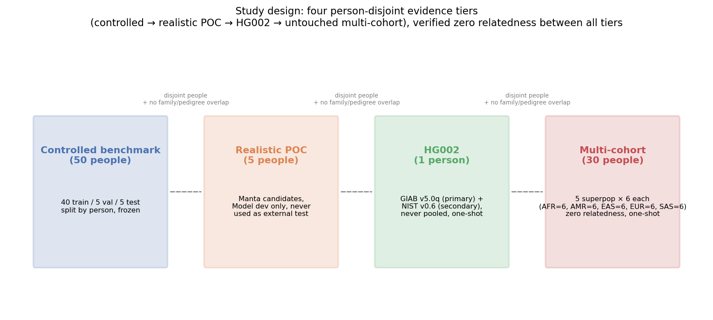
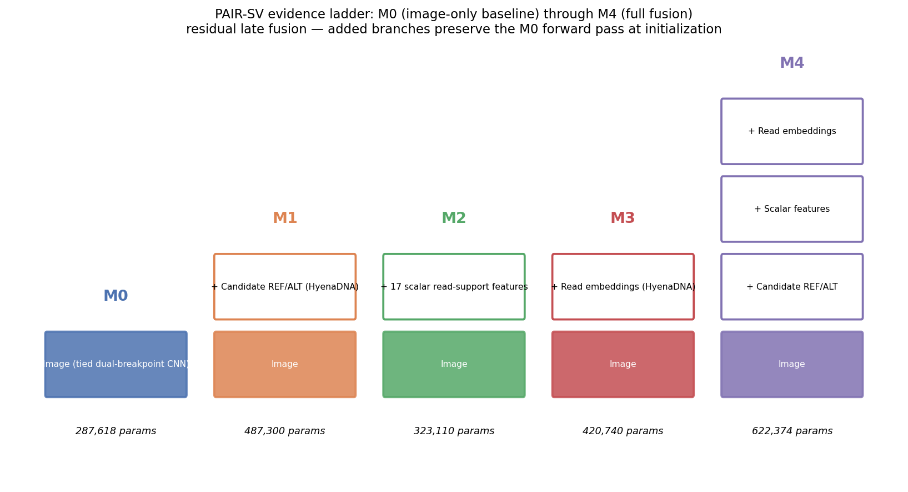

# PAIR-SV v1 manuscript — Methods sections (draft)

**Status: draft, in progress.** Covers manuscript sections 4-8 (Controlled multisample dataset; Same-site matched supervision; PAIR-SV architecture; Training and frozen evaluation protocol; Leakage and quality-control checks). Structural scaffolding only reused from `paper/PAIR_SV_Train15_article_draft.md`; every dataset/model/protocol/result number below is sourced fresh from the frozen Train40 artifacts (`train40_snapshot.json`, `reports/train40/`, `reports/test_evaluation/`, `reports/train40/frozen_checkpoint_checksums.json`), not copied from the Train15 interim report. No Train15 number appears anywhere below.

Sections 9 (controlled benchmark results), 10 (ablation results), 11-14 (realistic Manta benchmark / calibration / external validation / subgroups) are separate manuscript sections and are not drafted here — the corresponding source data already exists (`manta_poc/truvari_gate2/phase_f/PHASE_F_REPORT.md` for 11-12; sections 13-14 await Week 2-3 external-cohort execution).

---

## 4. Controlled multisample dataset

Candidate deletions and their same-site negatives were drawn from 50 unrelated individuals sequenced to high coverage (30x) by the expanded 1000 Genomes Project NYGC alignment set [byrska-bishop2022], aligned to GRCh38. Silver-standard genotype labels came from the HGSVC2 PanGenie-derived pangenome genotyping resource [ebert2021, ebler2022] (`pangenie_merged_bi_nosnvs.vcf.gz`, 3,202 samples).

The 50 people were split by person, before any extraction, into 40 train / 5 validation / 5 internal-test, with no person appearing in more than one split:

- Train (40): HG00096, HG00097, HG00099, HG00100, HG00101, HG00102, HG00103, HG00105, HG00403, HG00404, HG00406, HG00407, HG00409, HG00410, HG00419, HG00421, HG00551, HG00553, HG00554, HG00637, HG00638, HG00640, HG00641, HG00731, HG01583, HG01586, HG01589, HG01593, HG01879, HG01880, HG01882, HG01883, HG01885, HG01886, HG01889, HG01890, HG02490, HG02491, HG02493, HG02494.
- Validation (5): HG00106, HG00422, HG00732, HG01894, HG02597.
- Internal test (5, held untouched until one evaluation — see §7): HG00107, HG00428, HG00734, HG01896, HG02600.

A strict manifest of 100,000 sample-candidate rows (50,000 positive / 50,000 negative, exactly balanced by construction) was built from 12,272 same-site candidate pairs across the 50 people, gated on: schema/GT/GQ/FILTER validity, callability, genotype-conflict exclusion, coordinate consistency, and person-split integrity (`multisample_progress.md` R14). Positives require a non-missing 0/1 or 1/1 genotype with GQ>=20; negatives require a callable, conflict-free, non-missing 0/0 genotype at the identical locus in a different person (see §5). Deletions are sequence-resolved, 50-10,000bp, on autosomes only, with unambiguous GRCh38 coordinates.

CRAM feature extraction was run per shard (8 shards of 10,000 rows for train, one shard of 10,000 rows for validation, drawing 5 people per shard). Extraction succeeded for 79,801/80,000 attempted training rows (199 failures, 0.25%; class balance in the successful set: 39,842 positive / 39,959 negative) and 9,981/10,000 validation rows (19 failures, 0.19%). The internal-test extraction (§7) succeeded for 9,978 rows. Failures are retained as an explicit accounting category (`CandidateExtractionError`, predominantly empty reads at one or both breakpoints), never silently dropped.

Each successful row contains two `(6,64,128)` uint8 breakpoint pileup images, up to 48 selected read tokens per breakpoint with masks, 17 scalar read-support features, and deduplicated 1,024bp candidate REF/ALT sequence context. The six image channels encode base identity, base quality, mapping quality, strand, alignment state, and alternate-allele evidence. Sample identity, population label, split assignment, genotype quality, allele frequency, negative-type, source shard, and read-name hash are excluded from every model input tensor by construction (see §8 for the metadata-leakage check that verifies this exclusion is effective).

The Train40 snapshot is checksummed end to end: each of the 8 training shards has an independent SHA-256, and the full snapshot has a content fingerprint SHA-256 (`916bbcbdd54d5e34a345be2449373bef621b8cbb8e0ccfd53821b866215a1d33`, `train40_snapshot.json`) computed before any model saw the data.

| Dataset composition | Value |
|---|---|
| Total people | 50 (40 train / 5 validation / 5 internal test), person-disjoint |
| Strict manifest | 100,000 sample-candidate rows, 50,000/50,000 balanced by construction, 12,272 same-site candidate pairs |
| Train extraction | 79,801/80,000 successful (0.25% failure); 39,842 positive / 39,959 negative |
| Validation extraction | 9,981/10,000 successful (0.19% failure) |
| Internal-test extraction | 9,978 successful (§7) |
| Deletion length range | 50-10,000bp, sequence-resolved, autosomal |
| Snapshot integrity | per-shard + whole-snapshot SHA-256 fingerprint, computed pre-training |

**Figure 1. Study design and cohort separation.** Four person-disjoint evidence tiers: a 50-person controlled benchmark (40 train / 5 validation / 5 internal test), a 5-person realistic-candidate development study, GIAB HG002, and the untouched 30-person cohort (6 per continental superpopulation). Membership and family IDs were screened so that no person or family appears in more than one tier.

## 5. Same-site matched supervision

The central design choice of the dataset is that a candidate deletion's genomic locus (chromosome, coordinates, REF/ALT sequence context) is never unique to its label. Each same-site candidate pair places the identical locus twice in the manifest: once as a positive row (an individual with a confident 0/1 or 1/1 genotype at that site) and once as a negative row (a different individual with a confident, callable, conflict-free 0/0 genotype at the same site). The candidate REF/ALT sequence context and coordinate representation are therefore held constant within a matched pair — only the person-specific read evidence (the two breakpoint pileups, the selected reads, and the 17 scalar support features) differs between the positive and negative row of a pair.

This is a deliberate attempt to reduce the value of locus memorization as a shortcut: a model that only learned "this genomic coordinate is usually a real deletion" cannot separate the two rows of a same-site pair, since they share that coordinate. It does not eliminate every locus-related shortcut (e.g. the model still sees the reference and hypothesized-alternate sequence context, which is locus-determined), which is why the leakage probes in §8 test residual locus/metadata signal directly rather than relying on the same-site design alone as proof.

## 6. PAIR-SV architecture

PAIR-SV frames deletion verification as binary classification of a pre-selected, sequence-resolved candidate, not variant discovery. Five nested variants share a tied dual-breakpoint image encoder and differ only in which additional evidence branches are active, isolating each modality's marginal contribution under an otherwise identical architecture, optimizer, and training protocol:

| Variant | Images | Candidate REF/ALT | Sample reads | Scalars | Parameters (frozen, seed 20260720) |
|---|:---:|:---:|:---:|:---:|---:|
| M0 | yes | no | no | no | 287,618 |
| M1 | yes | yes | no | no | 487,300 |
| M2 | yes | no | no | yes | 323,110 |
| M3 | yes | no | yes | no | 420,740 |
| M4 | yes | yes | yes | yes | 622,374 |

The tied image encoder processes the left- and right-breakpoint pileups with shared convolutional weights, producing paired features plus their absolute difference and elementwise product. Candidate context (M1, M4) uses the 1,024bp REF and hypothesized-ALT sequence, encoded by a frozen HyenaDNA model (`LongSafari/hyenadna-small-32k-seqlen-hf`, pinned revision `8fe770c78eb13fe33bf81501612faeddf4d6f331`, 3,277,568 parameters) into REF, ALT, ALT-REF, |ALT-REF|, and junction embeddings (each 256-dimensional, 1,280-dimensional total). Sample reads (M3, M4) select up to 48 reads per breakpoint, tokenize to 128 bases, encode with the same frozen HyenaDNA model, and mask-aware mean-pool per side to a 768-dimensional left/right/|left-right| representation. The 17 scalar features (M2, M4) summarize clipping and split-read support, discordant-pair evidence, depth, mapping and base quality, insert-size anomaly, breakpoint balance, and log deletion length. Fusion is residual and late: additional branches are added on top of the image path in a way that preserves the image-only forward pass at initialization, so any measured gain reflects learned use of the added evidence rather than a change in the model's starting point.

**Figure 2. The M0-M4 evidence ladder.** Five nested variants share one tied dual-breakpoint image encoder and differ only in which evidence branches are active. Parameter counts are from the frozen seed-20260720 checkpoints. Fusion is residual and late, so each added branch preserves the image-only forward pass at initialization.

All 5 variants were trained with 3 independent seeds (20260720, 20260721, 20260722), 5 epochs, AdamW (learning rate 2×10⁻⁴, weight decay 10⁻⁴), batch size 16, mixed precision, cross-entropy loss — identical across variants and seeds, so that differences in outcome are attributable to the evidence branches, not to protocol variation. Per-model training time was ~2,400-2,470s per seed on the training infrastructure used.

## 7. Training and frozen evaluation protocol

Normalization statistics (scalar feature mean/std, candidate/read embedding mean/std) were fit on training people only, never on validation or test data. For each (model, seed), the checkpoint and decision threshold were selected by validation-set F1 across the 5 training epochs — this makes the validation-set numbers reported in §9 model-selection evidence, not an unbiased held-out estimate, and they are reported as such rather than conflated with the internal-test result.

Every frozen artifact — 15 checkpoints (5 models × 3 seeds), normalization statistics, decision thresholds, and the training/evaluation code itself (`deepsv/models/pairsv.py`, `deepsv/multisample/dataset.py`) — was checksummed (SHA-256) and locked (`reports/train40/frozen_checkpoint_checksums.json`) before the internal test was touched.

**The internal test was accessed exactly once.** All 5 models × 3 seeds were scored against the 5 held-out test people in a single pass (`evaluate_test_predictions.py`), joining predictions with labels for the first time only after every upstream artifact (checkpoints, thresholds, normalization, matching parameters, evaluation code) was already frozen. No threshold, feature, checkpoint, or hyperparameter was touched after this evaluation. The internal test remains permanently closed to further model development for PAIR-SV v1; a v2 model (if built) would be evaluated only on a new, separate cohort, never against this test set.

## 8. Leakage and quality-control checks

Three probes were run on the strict 100,000-row manifest before any model training, to test whether label information leaks through channels other than genuine read evidence:

| Probe | Result | Interpretation |
|---|---|---|
| Metadata-only classifier (identity/source-file-adjacent fields) AUC | 0.57484 | Below the pre-registered 0.65 ceiling — some residual signal exists in incidental metadata, but far from label-determining |
| Allele-frequency-only classifier AUC (train) | 0.50001 | Indistinguishable from chance |
| Allele-frequency-only classifier AUC (validation) | 0.50056 | Indistinguishable from chance |
| Train-locus prior applied to validation rows, AUC | 0.53066 | Modest — a classifier that only memorized which loci were positive in training generalizes only weakly to validation, consistent with the same-site design (§5) limiting but not eliminating locus shortcuts |

These checks gate every downstream result: had any probe exceeded its pre-registered ceiling, the manifest itself (not just a model) would have required revision before proceeding to training. All four passed their pre-registered thresholds.

Model input tensors exclude, by construction, sample identity, population label, split assignment, genotype quality, allele frequency, negative-type flag, source shard/file, and read-name hash (§4) — the metadata-probe result above is the direct empirical check that this exclusion is effective, not merely declared.

---

*Sourcing note for reviewers/co-authors: every number in this document traces to a specific file under version control — `train40_snapshot.json` (dataset composition, checksums), `reports/train40/` (training-time/validation metrics, frozen checkpoint checksums), `reports/test_evaluation/` (internal-test results, referenced in §7 but reported in §9, not drafted here), and `multisample_progress.md` (leakage-probe run log, entry R14). No number here was estimated, rounded from memory, or carried over from the Train15 interim report.*
