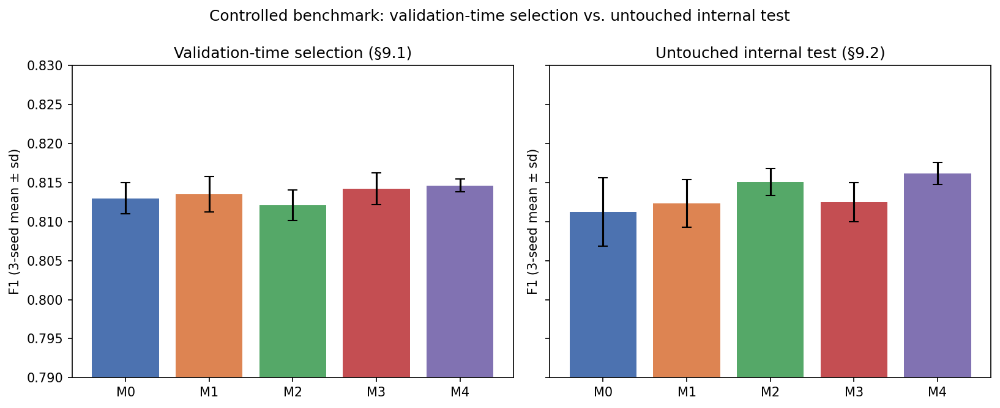
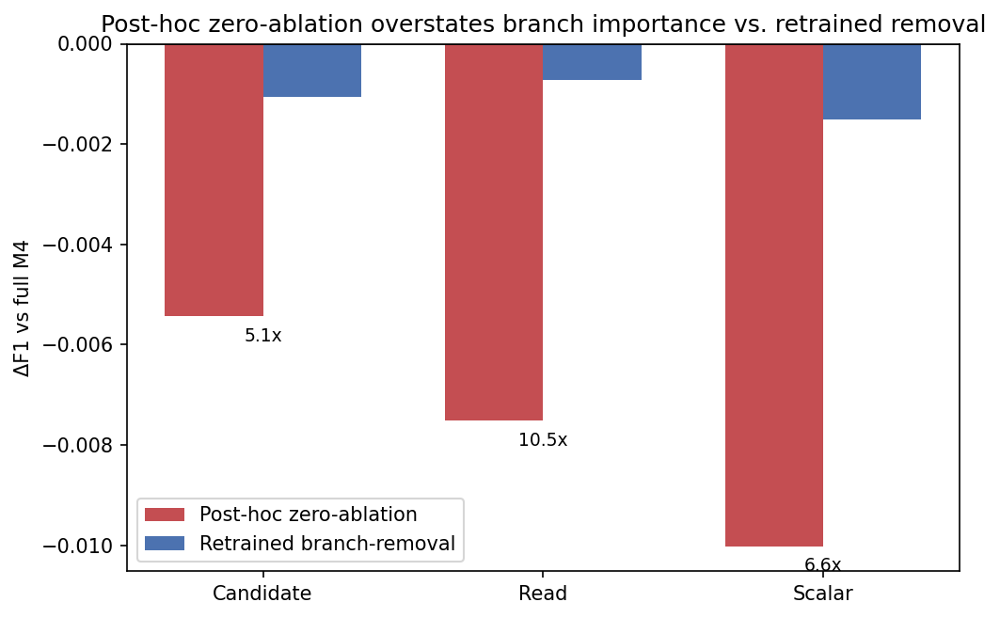
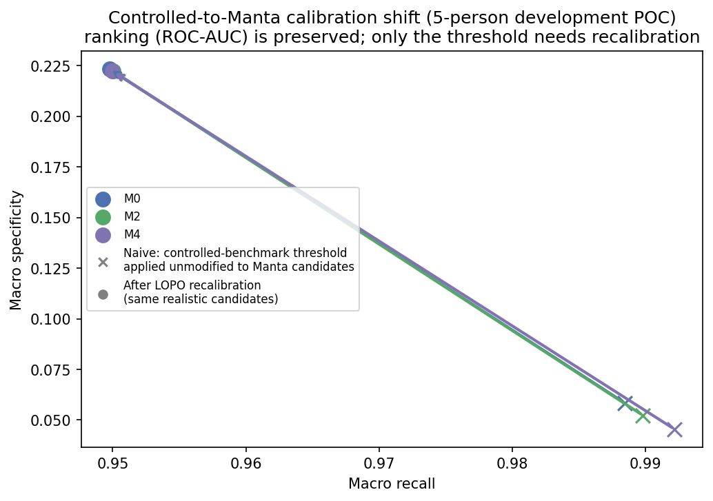
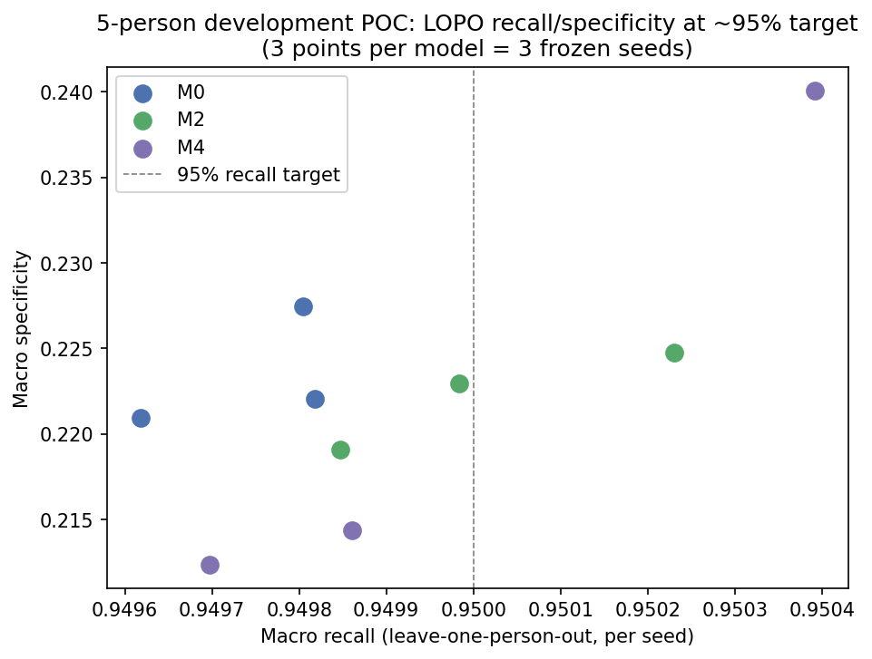
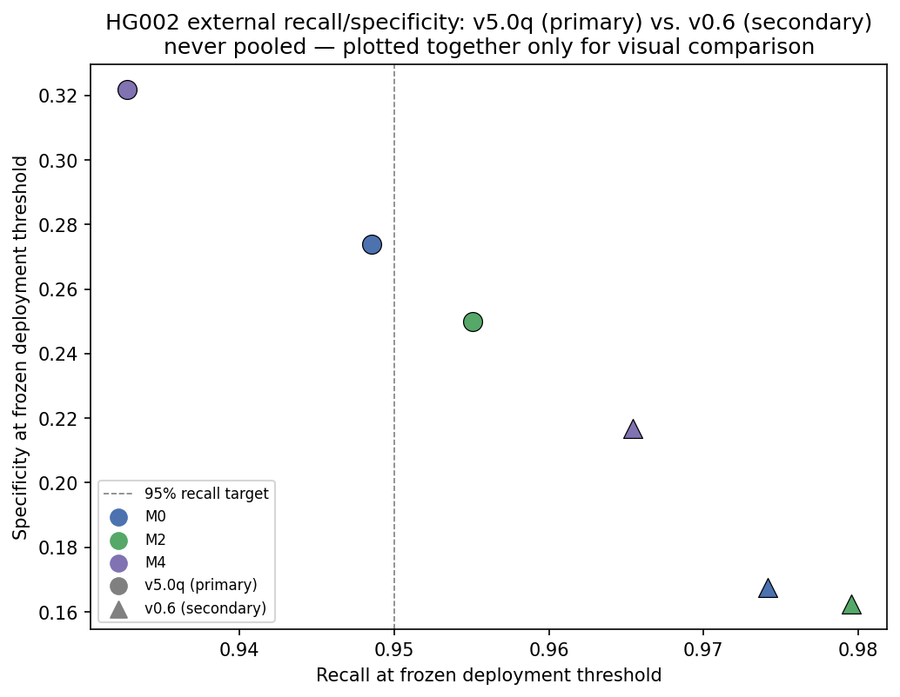
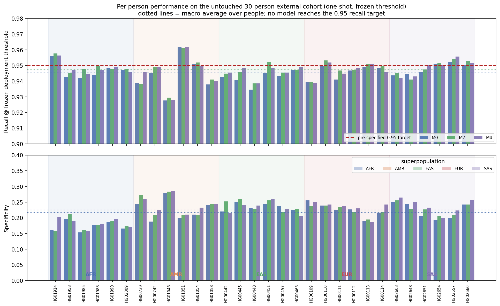
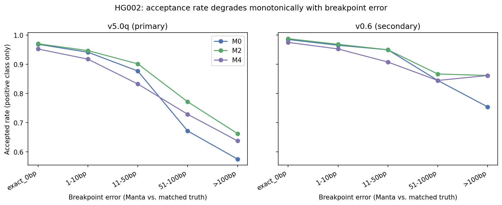

# PAIR-SV v1 manuscript — Results sections (draft)

**Status: draft, sections 9-14 complete** (§9-10 controlled/ablation, §11-12 realistic-candidate development POC, §13-14 both HG002 external passes). The untouched 30-person multi-person cohort (evidence tier 8) is **complete** and reported in §15.12 of `discussion_limitations_conclusion_v1_draft.md`, evaluated exactly once under the frozen protocol. Remaining: §1-3 (Abstract deliberately written last), see `intro_related_work_v1_draft.md`.

## Evidence-tier index

This manuscript reports evidence at eight progressively less controlled, more realistic tiers. They are never pooled or averaged into a single headline number — each answers a different question, and conflating them (e.g., quoting a controlled-benchmark F1 as if it were the external-validation result) would misrepresent what has actually been shown. This index exists specifically so no tier's result can be mistaken for another's.

| # | Tier | People | Candidate source | Truth source | Section | Status |
|---|---|---|---|---|---|---|
| 1 | Controlled validation | 5 val (of 50) | curated same-site pairs | PanGenie silver-standard | §9.1 | complete — **not** an unbiased estimate (used for model/threshold selection) |
| 2 | Untouched internal test | 5 test (of 50), never used for selection | curated same-site pairs | PanGenie silver-standard | §9.2 | complete — the controlled-benchmark headline result, accessed exactly once |
| 3 | Retrained ablations | same 5 test | curated same-site pairs | PanGenie silver-standard | §10 | complete — retrained branch-removal vs. post-hoc zero-ablation, both reported |
| 4 | Realistic-candidate development POC | 5 (HG00108/HG01912/HG00736/HG00436/HG02601), excluded from every other tier | real whole-genome Manta output | two-pass PanGenie (carrier + reference-check) | §11 | complete — characterizes curated-vs-real calibration shift |
| 5 | Frozen LOPO calibration | same 5 | real Manta output | same two-pass PanGenie | §12 | complete — the threshold-selection procedure later frozen and reused unmodified in tiers 6-8 |
| 6 | Untouched HG002 external validation (primary) | 1 (HG002), never used elsewhere | real whole-genome Manta output | GIAB v5.0q GRCh38 (Draft, assembly-based) | §13 | complete — opened exactly once |
| 7 | HG002 sensitivity pass (secondary) | HG002, separate GRCh37 alignment/pipeline | real whole-genome Manta output | NIST SV v0.6 Tier1 GRCh37 (mature, incomplete) | §13 | complete — **never pooled** with tier 6; reported as agreement/disagreement, not averaged |
| 8 | Untouched multi-person external cohort | 30 (6 per superpopulation), never used elsewhere | real whole-genome Manta output | two-pass PanGenie | §15.12 | **complete — opened exactly once**; all 30 selected people completed the pipeline with no replacement, pre-evaluation state frozen in `manta_poc/COHORT_PRE_EVALUATION_MANIFEST.json`, result in `manta_poc/cohort_final_evaluation_report.json` (sha256 `84f571b6…b3d1`) |

Tiers 1-3 use the same 50-person controlled cohort (disjoint train/val/test splits) and curated same-site candidate pairs — they measure architecture quality in isolation from any real-world candidate-distribution shift. Tiers 4-5 introduce real, unfiltered Manta output for the first time, on people still excluded from every controlled-benchmark split, and exist specifically to characterize and correct for the resulting calibration shift (§15.7) before any untouched data is examined. Tiers 6-8 are the actual untouched external evidence: single-person (6-7) and population-level (8), primary-truth-source (6) and sensitivity-analysis (7), all using the tier-5 calibration procedure completely unmodified.

---

## 9. Controlled benchmark results

### 9.1 Validation-time model selection (not an unbiased estimate — see §7)

Across 3 seeds, validation F1 was closely clustered across all 5 variants (0.8113-0.8161 mean), with M4 highest and M3 lowest:

| Model | F1 (mean±sd) | ROC-AUC (mean) | PR-AUC (mean) | MCC (mean) |
|---|---|---|---|---|
| M0 | 0.8130±0.0020 | 0.8972 | 0.9075 | 0.6148 |
| M1 | 0.8135±0.0023 | 0.8997 | 0.9088 | 0.6133 |
| M2 | 0.8121±0.0020 | 0.8994 | 0.9091 | 0.6144 |
| M3 | 0.8142±0.0020 | 0.8982 | 0.9075 | 0.6120 |
| M4 | 0.8146±0.0008 | 0.9011 | 0.9097 | 0.6162 |

This is model-selection evidence (checkpoint/threshold chosen by validation F1, §7) — reported for completeness, not as the headline result.

### 9.2 Internal one-shot test (the controlled-benchmark result — accessed exactly once, §7)

3-seed mean, 5 models, 9,978 test rows (5 held-out people: HG00107, HG00428, HG00734, HG01896, HG02600):

| Model | Precision | Recall | F1 | ROC-AUC | PR-AUC | MCC |
|---|---|---|---|---|---|---|
| M0 | 0.7770±0.0220 | 0.8502±0.0253 | **0.81127**±0.0044 | 0.8982 | 0.9063 | 0.6091 |
| M1 | 0.7760±0.0035 | 0.8523±0.0071 | **0.81233**±0.0030 | 0.8996 | 0.9073 | 0.6100 |
| M2 | 0.7905±0.0088 | 0.8414±0.0083 | **0.81506**±0.0017 | 0.9012 | 0.9087 | 0.6203 |
| M3 | 0.7709±0.0070 | 0.8589±0.0033 | **0.81248**±0.0025 | 0.8991 | 0.9068 | 0.6083 |
| M4 | 0.7831±0.0073 | 0.8523±0.0109 | **0.81613**±0.0014 | 0.9018 | 0.9083 | 0.6194 |

M4 has the highest mean F1, ROC-AUC, and MCC; M2 is a close second and has the highest mean precision. **M0's cross-seed F1 standard deviation (0.0044) is markedly higher than every fusion variant's (0.0014-0.0030)** — the image-only baseline is less stable across random seeds than any variant with additional evidence branches, a secondary but notable finding in its own right.

**Figure 3. Controlled benchmark: validation-time selection versus the untouched internal test.** F1 as 3-seed mean with standard deviation, for all five variants. Validation numbers (left) were used to select checkpoints and thresholds and are not an unbiased estimate; the internal test (right) was opened once.

**Candidate-cluster bootstrap** (2,000 resamples, 4,260 unique candidate clusters — not row-level, since candidates recur across the same-site design; this is the statistically appropriate unit given §5):

| Comparison | ΔF1 (mean) | 95% CI | Win proportion | Conclusion |
|---|---|---|---|---|
| M4 − M0 | +0.00490 | [+0.00139, +0.00832] | 0.997 | **excludes zero** |
| M2 − M0 | +0.00379 | [+0.00097, +0.00674] | 0.9955 | **excludes zero** |
| M1 − M0 | +0.00110 | [−0.00151, +0.00385] | 0.786 | crosses zero |
| M3 − M0 | +0.00121 | [−0.00184, +0.00425] | 0.7885 | crosses zero |
| M4 − M2 | +0.00106 | [−0.00227, +0.00433] | 0.741 | crosses zero |

**Interpretation, precisely stated:** M4 and M2 both significantly exceed the image-only baseline M0. **M4 does not significantly exceed M2** (CI crosses zero) — the scalar read-support branch alone captures most of the measurable improvement over M0; adding candidate-sequence and read-embedding evidence on top of it (the difference between M2 and M4) does not demonstrate a further, statistically supported gain on this test set. Single-modality-addition variants M1 (candidate sequence only) and M3 (read embeddings only) do not significantly exceed M0 alone.

**50-200bp length-restricted candidate-cluster bootstrap** (2,798 clusters): M4 − M0 ΔF1 +0.00351, 95% CI [−0.00051, +0.00782], win proportion 0.948 — **borderline, does not clear the 95% threshold**. No evidence that fusion (M4) helps disproportionately on short deletions specifically, contrary to a plausible a priori hypothesis that short-deletion pileups might benefit most from additional sequence/read evidence.

**Leave-one-person-out stability** (F1 mean with each of the 5 test people excluded in turn): all 5 models are stable, standard deviation across the 5 leave-one-out estimates ranging 0.0013-0.0024 model, indicating the headline result does not hinge on any single test person.

**Same-site-negative specificity** (test set, frozen threshold): M2 highest (0.7775 mean), M3 lowest (0.7455 mean) — the scalar branch (present in M2 and M4) is specifically associated with better same-site-negative rejection, consistent with §10's branch-dependence finding.

## 10. Ablation methodology and results

Two distinct ablation designs were used. Their results measure different things and are reported separately:

1. **Post-hoc perturbation** (zero and shuffle) of a single frozen M4 checkpoint's inputs at inference time, no retraining. Cheap, but the model was never trained to be robust to the perturbed distribution, so effect sizes can be inflated by pushing the model out of its training distribution rather than by removing genuine information content.
2. **Retrained branch-removal** — M4_NO_CANDIDATE, M4_NO_READ, M4_NO_SCALAR: the corresponding branch structurally removed from the architecture and the model retrained from scratch with the same protocol (3 seeds, 5 epochs) as every other variant. This measures the branch's marginal contribution when the rest of the network is allowed to compensate, which is what actually matters for an architecture decision.

### 10.1 Post-hoc zero-ablation (single frozen M4 checkpoint, validation set, 3 seeds)

| Intervention | ΔF1 (mean) | ΔROC-AUC | ΔPR-AUC |
|---|---|---|---|
| candidate_zero | −0.00543±0.0014 | −0.0041 | −0.0025 |
| read_zero | −0.00751±0.0021 | −0.0069 | −0.0049 |
| scalar_zero | **−0.01002**±0.0017 | −0.0106 | −0.0103 |

Scalar zeroing produces the largest drop; shuffle interventions were directionally unstable (e.g. `scalar_shuffle` *increased* F1 by +0.0301 in the single-seed diagnostic run investigating the `mean_abs_insert_size` pathology — see the Discussion/Limitations section for the scalar-normalization defect this anomaly led to identifying) and are not treated as reliable ablation evidence.

### 10.2 Retrained branch-removal (validation set, 3 seeds — the methodologically preferred design)

| Variant | ΔF1 vs full M4 (mean) |
|---|---|
| M4_NO_CANDIDATE | −0.00107 |
| M4_NO_READ | −0.00072 |
| M4_NO_SCALAR | −0.00151 |

### 10.3 Post-hoc zero-ablation overstates branch importance by ~5-10x relative to retrained removal

Directly comparing the two designs' F1 drops for the same three branches:

| Branch | Post-hoc zero ΔF1 | Retrained-removal ΔF1 | Ratio (overstatement) |
|---|---|---|---|
| Candidate | −0.00543 | −0.00107 | **5.1x** |
| Read | −0.00751 | −0.00072 | **10.5x** |
| Scalar | −0.01002 | −0.00151 | **6.6x** |

**Figure 4. Post-hoc zero-ablation compared with retrained branch-removal.** ΔF1 for removing each of the three added branches, measured two ways. Annotations give the ratio between the two designs: post-hoc zeroing yields drops 5.1x (candidate), 10.5x (read) and 6.6x (scalar) larger than retraining the model without that branch.

This is the primary ablation finding: **naive post-hoc zero-ablation overstates each modality's true marginal contribution by roughly 5-10x** relative to a properly retrained branch-removal control. The retrained-removal numbers themselves are small (0.07-0.15 F1 percentage points per branch) — consistent with the branches being **largely redundant with each other rather than strongly additive**, and consistent with §9.2's finding that M4 does not significantly exceed M2 on the internal test. Neither ablation design provides evidence that any single added modality is strictly necessary; each contributes a small, measurable, but individually modest amount, and removing any one is largely compensated for by the rest of the network.

No evidence was found (§9.2, 50-200bp bootstrap) that fusion (M4) preferentially benefits short (50-200bp) deletions specifically, despite this being a plausible a priori hypothesis for why additional sequence/read evidence might matter most.

---

## 11. Realistic Manta-candidate benchmark (5-person development POC)

**This is a development POC result, not the final external validation.** It uses 5 people (HG00108, HG00436, HG00736, HG01912, HG02601) whose PanGenie-based truth was already available during model/threshold development (Phase F, decisions 0037-0041) — they are explicitly excluded as an external test set (see §7 and the hard constraints in `paper/PUBLICATION_LEDGER.md`). Its purpose here is to characterize how the controlled-benchmark models behave on **realistic, unfiltered Manta candidates** (as opposed to the curated same-site pairs of §9) and to validate the LOPO calibration procedure that is then applied, unmodified, to the untouched external cohort in §13.

Manta was run whole-genome on each of the 5 people and its PASS DEL candidates were matched against two-pass PanGenie truth (carrier and reference-check Truvari passes; positive / known_negative / unknown labels — see `manta_poc/truvari_gate2/gate2_pipeline.py`). Candidate composition:

| person | positive | known_negative | unknown | confidently-labeled fraction |
|---|---|---|---|---|
| HG00108 | 2,957 | 326 | 867 | 0.791 |
| HG00436 | 2,936 | 347 | 886 | 0.788 |
| HG00736 | 2,945 | 375 | 847 | 0.797 |
| HG01912 | 3,011 | 629 | 1,278 | 0.740 |
| HG02601 | 3,026 | 339 | 903 | 0.788 |

HG01912 (ACB/AFR) shows a visibly larger known-negative/unknown fraction, consistent with a known population effect (more divergence from a European-reference-derived panel, more sites outside PanGenie's coverage) rather than a processing anomaly.

**Accept-all-Manta baseline** (label every PASS DEL positive — the naive floor any model must beat): recall=1, specificity=0 by construction; precision/F1 are already high (0.83-0.90 precision, 0.90-0.95 F1) purely because prevalence is high, which is why **F1 is not a useful discriminator here** — a model must be judged on how much it can shrink specificity's floor while holding recall near-fixed, which is exactly what §11's LOPO calibration (below) measures, not on F1 alone.

**Frozen-threshold transfer** (applying the Train40-controlled-benchmark operating point unmodified to Manta candidates): specificity collapses to 4-7% (predicted-positive rate 98-99%) across all three models and all three seeds, while ROC-AUC stays stable at 0.75-0.76. The controlled-benchmark threshold does not transfer to the realistic candidate distribution — but the underlying ranking remains informative (ROC-AUC well above chance), meaning the threshold, not the model's discrimination, is what needs recalibrating for this distribution shift.

**Figure 5. Threshold transfer from curated pairs to real Manta candidates.** Applying the controlled-benchmark operating point unmodified to real candidates drives specificity to 4-7%; leave-one-person-out recalibration on the 5-person development study restores it to 21-24% at the ~95% recall target. ROC-AUC is stable across both settings.

## 12. Person-level LOPO calibration — the primary POC-scale result

Leave-one-person-out (LOPO): a threshold is selected on 4 of the 5 people (holding macro recall at a target level across their pooled positives), then applied unmodified to the 5th, held-out person. Repeated for all 5 held-out people × 3 models (M0/M2/M4) × 3 seeds × 3 target recall levels (99/95/90%) — 135 total folds.

**Primary operating point: 95% target recall**

| model | seed | recall macro (worst fold) | specificity macro (range) |
|---|---|---|---|
| M0 | mean of 3 seeds | 0.9497 (0.9415 worst) | 0.224 (0.182-0.264) |
| M2 | mean of 3 seeds | 0.9500 (0.9416 worst) | 0.222 (0.182-0.264) |
| M4 | mean of 3 seeds | 0.9500 (0.9415 worst) | 0.222 (0.175-0.295) |

All 45 held-out folds (5 people × 9 model×seed combinations) hold macro recall within 0.9415-0.9504 of the 0.95 target and **none falls to specificity ≤ 0.10** — a threshold selected on 4 people transfers to the 5th without failure in every fold tested. At the conservative 99%-recall setting specificity drops to 5-7% (0/45 folds exceed the 0.10 floor); at the more aggressive 90%-recall setting specificity rises to 35-38% — a monotonic, gap-free recall/specificity trade-off consistent with a stable, content-driven ranking rather than noise.

**Figure 6. Leave-one-person-out calibration on the 5-person development study.** Macro recall against macro specificity at the 95% target, one point per frozen seed and model. The dashed line marks the 95% recall target used to select the deployment thresholds.

**Decision-rule check against the predefined Phase F criteria (all satisfied, not marginally):**

| criterion | threshold | worst observed | status |
|---|---|---|---|
| macro held-out recall | ≥ 0.93 | 0.9496 | met |
| macro specificity | ≥ 0.20 | 0.2124 | met |
| people with specificity > 0.10 | ≥ 4/5 | 5/5 (all 9 combos) | met |
| individual-person held-out recall | ≥ 0.90 | 0.9415 | met |
| ROC-AUC above chance | — | 0.748-0.764 | met |

This did not reach the "strong success" bar of the pre-registered decision rule (30-40% specificity at ~95% recall; the label is the rule's own) — actual macro specificity is 21-24%, below that bar. **Verdict: 0.4A** — calibration without retraining is sufficient; PAIR-SV v1 at a properly recalibrated (not frozen-controlled-benchmark) threshold removes roughly a fifth to a quarter of false Manta candidates while retaining ~95% of true deletions, a modest but real and person-transferable signal (5 people spanning AFR/AMR/EAS/SAS ancestry).

M0, M2, and M4 perform near-identically at this operating point (macro specificity 0.212-0.240) — the pairwise M0-vs-fusion difference in sign is inconsistent across seeds, i.e. **no model shows a reproducible advantage over the others at POC scale (n=5 people)**, consistent with §9.2/§10's finding that added modalities contribute only a small, largely redundant increment over the image+scalar baseline.

**Subgroup behavior at the frozen threshold:** ROC-AUC is stable across length buckets (0.70-0.78 for 50-200bp, 200-1000bp, and 1000-10,000bp candidates — no single length range drives performance). Among true positives, acceptance rate/confidence degrades monotonically as breakpoint error from the PanGenie-truth coordinate grows (99.5% accepted at exact match down to 88.8% beyond 100bp error), and heterozygous genotypes are accepted slightly less often than homozygous-alt (98.4% vs 99.6%) — both patterns are content-consistent, not artifacts of noise. Unknown-class candidates (sites PanGenie did not genotype, never used in supervised metrics) receive predicted-positive rates (93-95%) nearly as high as confirmed positives, consistent with them being ungenotyped rather than rejected sites.

This 5-person result establishes that the LOPO calibration procedure is well-behaved and transfers reliably between people — it is the basis for §13's untouched-external-cohort evaluation, where the same procedure (unmodified) is applied once to GIAB HG002 and is not itself re-tuned there.

## 13. Untouched external validation (GIAB HG002) — the frozen, one-shot result

**This section reports the single, frozen evaluation of PAIR-SV v1 against GIAB HG002, opened exactly once, per `manta_poc/EXTERNAL_EVAL_PROTOCOL_FROZEN.md` (base protocol + ADDENDUM, decision 0046) and executed end to end without any post-hoc tuning of thresholds, matching parameters, candidate filters, models, or feature processing.** HG002 is a person never seen during model development, threshold calibration (§12), or the internal one-shot test (§9.2), and was untouched until this evaluation.

**Pipeline.** Whole-genome Manta 1.6.0 (identical frozen container digest to every other sample in this project) was run on `HG002.GRCh38.60x.1.bam` (GIAB/NHGRI, Illumina, 60x, Novoalign, 126,230,242,948 bytes, self-computed SHA256 `e2cb894b...cf77f26`, chosen for platform consistency with all 6 prior samples). The first Manta attempt failed `configManta`'s contig-set validation in 33s (the BAM's 2,580 contigs, while a strict subset of this project's 3,366-contig reference, are not an *exact* match, and Manta requires exact equality) — fixed, and reported here rather than hidden, by extracting a subset reference containing exactly the BAM's contig set via `samtools faidx` (verified byte-identical contig names to the BAM header; same GRCh38 sequences, only the extra ALT/HLA/decoy contigs the BAM's own aligner never used are omitted). The resubmitted run completed successfully: exit code 0, elapsed 1,962s, 6,613 raw DEL records in `diploidSV.vcf.gz` (SHA256 `5af8c0fb...b914540b`).

Manta's PASS DEL candidates were matched against GIAB v5.0q GRCh38 truth (assembly-based, dipcall on the T2T-HG002-Q100-v1.1 diploid assembly; **Draft status, not yet peer-reviewed** — stated explicitly here per the mission's truth-source constraint) using the frozen Truvari 5.4.0 parameters (identical to every other Truvari pass in this project) plus the ADDENDUM's benchmark-region rule (candidate included only if both deletion breakpoints fall inside the v5.0q confident-region BED). Manta's own end-to-end recall against v5.0q truth in benchmark regions was 42.7% (4,333/10,143 truth deletions matched) — reported here as a separate evaluation level per ADDENDUM §12, **not to be confused with or conflated with PAIR-SV's performance as a filter of Manta's own candidates below**, which is a categorically different question (can PAIR-SV distinguish Manta's true from false candidates, not can Manta find every truth deletion in the first place).

**Candidate composition** (5,461 total Manta PASS DEL): **4,333 positive** (Truvari-matched), **512 known_negative** (unmatched, fully inside benchmark regions), **616 excluded** (outside/crossing benchmark-region boundaries, per the benchmark-region rule — never treated as false positives). Of the 4,845 confidently-labeled candidates, 84 fell outside the predefined 50-10,000bp scope tier (`unsupported_length_gt_10000bp`, per ADDENDUM §11) and were excluded from scoring; extraction succeeded for 4,756/4,761 eligible candidates (99.9%; 5 `CandidateExtractionError` failures, reported not hidden).

**Accept-all-Manta baseline** (label every PASS DEL positive): prevalence 0.903, recall=1, specificity=0 by construction, F1=0.949 — again a high but uninformative floor, per §11's F1 caveat.

**Primary result — specificity at the frozen ~95%-recall deployment threshold** (3-seed-ensembled probability, threshold frozen in Week 1 from the 5-person POC, applied here completely unmodified):

| model | recall | specificity | precision | F1 | balanced acc. | MCC | ROC-AUC | PR-AUC | filtered-candidate rate |
|---|---|---|---|---|---|---|---|---|---|
| M0 | 0.9486 | **0.2739** | 0.9242 | 0.9362 | 0.6112 | 0.2528 | 0.7906 | 0.9713 | 0.0730 |
| M2 | **0.9551** | 0.2500 | 0.9224 | 0.9385 | 0.6025 | 0.2463 | 0.7889 | 0.9703 | 0.0648 |
| M4 | 0.9327 | **0.3217** | 0.9278 | 0.9302 | 0.6272 | 0.2604 | 0.7865 | 0.9698 | 0.0919 |

**At the frozen threshold:** M2 is the only model that clears the ~95% recall target on this external cohort (0.9551); M0 comes close (0.9486); **M4 falls short of the 95% target (0.9327)** while achieving the highest specificity of the three (0.3217 vs 0.2739/0.2500). This is the opposite ordering from the 5-person POC's LOPO calibration (§12), where M0/M2/M4 were statistically indistinguishable (specificity 0.212-0.240 for all three) — on untouched external data, M4's higher specificity comes with a recall cost that the frozen threshold (calibrated on the 5-person POC, not retuned here) does not fully compensate for. Per the mission's hard constraint, **no model is selected or preferred based on this result, and no threshold is retuned** — all three are reported as run. Specificity at the frozen threshold is 0.2500-0.3217 here, against 0.212-0.240 for the 5-person POC (§12). The two use different truth sources (PanGenie vs GIAB v5.0q) and are not directly comparable in absolute terms. The 30-person cohort later measured 0.2167-0.2253 (§15.12), which is broadly consistent with the POC range. Against those two tiers, the v5.0q values reported here are the higher ones, and v5.0q appears as the high-specificity outlier among the three. We draw no conclusion from this section alone about whether the POC estimate was optimistic or pessimistic; that comparison requires more than one external genome.

**Figure 7. HG002 recall and specificity at the frozen threshold, under two truth sources.** GIAB v5.0q (primary) and NIST SV v0.6 (secondary sensitivity pass). The two are never pooled; they are plotted together only for visual comparison. The dashed line marks the 95% recall target.

**Length subgroups** (per ADDENDUM §11 scope tiers):

| bucket | model | recall | specificity | ROC-AUC | n |
|---|---|---|---|---|---|
| 50-200bp (primary) | M0 | 0.9247 | 0.2830 | 0.7368 | 2,503 |
| 50-200bp (primary) | M2 | 0.9329 | 0.2830 | 0.7397 | 2,503 |
| 50-200bp (primary) | M4 | 0.8905 | 0.3762 | 0.7353 | 2,503 |
| 200-1000bp (secondary) | M0 | 0.9908 | 0.1776 | 0.8666 | 1,626 |
| 200-1000bp (secondary) | M2 | 0.9921 | 0.1776 | 0.8647 | 1,626 |
| 200-1000bp (secondary) | M4 | 0.9868 | 0.1589 | 0.8631 | 1,626 |
| 1000-10000bp (exploratory) | M0 | 0.9282 | 0.4524 | 0.8065 | 627 |
| 1000-10000bp (exploratory) | M2 | 0.9419 | 0.1905 | 0.7796 | 627 |
| 1000-10000bp (exploratory) | M4 | 0.9504 | 0.3333 | 0.7951 | 627 |

Recall/specificity/ROC-AUC vary meaningfully by length bucket (specificity is consistently lowest in the 200-1000bp range across all three models — the hardest region to reject known negatives in) but no bucket collapses to chance-level ROC-AUC (all buckets 0.74-0.87) — consistent with §11's finding on the 5-person POC that no single length range drives performance.

**Breakpoint-error subgroups** (positive class only, Truvari's own StartDistance/EndDistance from `tp-comp.vcf.gz`, M4 shown; M0/M2 show the same monotonic pattern, see `manta_poc/hg002_external/hg002_final_evaluation_report.json` for all three):

| bucket | n | accepted rate | median score |
|---|---|---|---|
| exact_0bp | 3,397 | 0.952 | 0.992 |
| 1-10bp | 546 | 0.918 | 0.980 |
| 11-50bp | 203 | 0.833 | 0.950 |
| 51-100bp | 70 | 0.729 | 0.869 |
| >100bp | 80 | 0.637 | 0.803 |

Same monotonic degradation pattern as the 5-person POC (§11's breakpoint-error subgroup) — acceptance/confidence falls as the Manta candidate's breakpoints diverge further from the matched truth coordinate, replicated on external data.

**Secondary/sensitivity pass (NIST SV v0.6, GRCh37) — completed, reported separately, never pooled with the primary v5.0q result above.**

Run as an entirely separate pipeline pass: a native GRCh37 HG002 alignment (`HG002.hs37d5.60x.1.bam`, same NHGRI Illumina 300X AJtrio Novoalign 60x series as the primary GRCh38 BAM, aligned to `hs37d5` — the exact reference the README documents Novoalign as having used), Manta run against the unmodified `hs37d5.fa` reference (contigs matched exactly on the first attempt, no subset-reference workaround needed this time), and Truvari matched against NIST SV v0.6 Tier1 truth using this project's own frozen parameters (not the v0.6 README's own suggested `-r 2000`, for metric-definition consistency with every other pass in this project — a deliberate, documented choice). Same frozen M0/M2/M4 checkpoints, seed-ensemble procedure, and deployment thresholds as the primary pass; predictions hashed before any label was loaded.

Candidate composition (5,385 total Manta PASS DEL): 3,008 positive, 232 known_negative, 2,145 excluded by the benchmark-region rule. Manta's own end-to-end recall against v0.6 truth in benchmark regions was 71.6% (3,008/4,199 truth deletions matched) — markedly higher than the 42.7% observed against v5.0q, consistent with v0.6's documented bias toward easier, better-supported SVs (§15.10). Extraction succeeded for 3,183/3,184 eligible candidates (99.97%).

**Primary result at the frozen threshold:**

| model | recall | specificity | precision | F1 | balanced acc. | MCC | ROC-AUC | filtered-candidate rate |
|---|---|---|---|---|---|---|---|---|
| M0 | 0.9742 | 0.1675 | 0.9450 | 0.9594 | 0.5708 | 0.1887 | 0.7397 | 0.0349 |
| M2 | **0.9795** | 0.1626 | 0.9450 | 0.9619 | 0.5710 | 0.2051 | 0.7414 | 0.0295 |
| M4 | 0.9654 | **0.2167** | 0.9476 | 0.9564 | 0.5911 | 0.2121 | 0.7432 | 0.0462 |

**The v0.6 pattern differs from v5.0q.** The two are reported separately, per the evidence-tier index. On v5.0q, only M2 cleared the 95% recall target and M4 fell short (§13). On v0.6, **all three models clear ~95%+ recall** (M0 97.4%, M2 98.0%, M4 96.5%), and M4 again has the highest specificity (0.2167) but this time without missing the recall target. Absolute specificity is lower across the board on v0.6 than on v5.0q (16-22% vs. 25-32%) — plausibly because v0.6's easier-SV-biased truth set makes its "known negative" candidates (Manta PASS DEL calls with no v0.6 truth match) systematically harder to distinguish from true positives than v5.0q's known negatives, though this is offered as a hypothesis, not a demonstrated mechanism. The two truth sources agree that M4 achieves the highest specificity of the three models, but disagree on whether that comes bundled with a recall shortfall — a genuine, non-trivial discrepancy between a Draft assembly-based benchmark and a mature-but-incomplete read-support benchmark, reported honestly rather than resolved in favor of either.

Length subgroups and breakpoint-error subgroups show the same qualitative patterns already established on v5.0q and the 5-person POC (ROC-AUC stable across length buckets, 0.63-0.81; breakpoint-error acceptance rate degrades monotonically with distance from the matched truth coordinate) — full tables in `manta_poc/hg002_v0.6_external/hg002_v0.6_final_evaluation_report.json`.

**From one genome to thirty.**

The ordering above invites a model-level reading: that M2's calibration transfers more faithfully than M4's, and that the fusion model is the more fragile of the two under distribution shift. We entertained that reading. §15.3 records it.

It rests on one genome. Recall, specificity, and the gap between them are properties of one individual's candidate population — HG002's variant profile, its sequencing run, and the few thousand deletions Manta proposed in it. Nothing in this section separates "M4's threshold transfers less well than M2's" from "M4's threshold transferred less well on this person." More analysis of HG002 cannot settle it. More people can.

The 30-person cohort (§15.12) was assembled to settle it. Its membership, purpose and protocol were fixed in advance: the cohort was selected deterministically before any Manta run, six people per continental superpopulation, screened for relatedness against every earlier cohort in this study; the deployment thresholds were the frozen values used here and were not retuned; and the evaluation script, metric definitions, subgroup definitions and sample inclusion were checksummed before any cohort label was opened. The cohort tested a pre-stated question about generalisation across people. It was not a search for a model that scored better, and no model was selected, promoted or re-ranked on its result.

The ordering did not replicate. Across 30 people, M2 and M4 differ in macro-averaged recall by 0.000176, against a between-person standard deviation of 0.0062 (Figure 8).

**Figure 8. Per-person performance on the untouched 30-person cohort.** Recall (top) and specificity (bottom) for M0, M2 and M4 on each of the 30 individuals, at the deployment threshold calibrated once on the 5-person development study and not retuned. Dotted lines are macro-averages over people; the dashed line in the upper panel is the pre-specified 0.95 recall target, which no model reaches. Background bands group individuals by continental superpopulation. Values are read from the frozen evaluation report, whose SHA-256 is verified before plotting.

Two statements should be kept apart here. The cohort shows that the HG002 recall difference between M2 and M4 does not persist at cohort scale. It does not establish that the HG002 difference was itself sampling variation rather than a real difference on that individual. We did not pre-specify a test of whether the HG002 M2-M4 difference was nonzero, and we do not run one now. What the cohort licenses is a statement about generalisation across people, not a retrospective verdict on the single-genome measurement. Two results did carry over: no model reached the pre-specified 95% recall target, and M4 had the highest specificity, as on both HG002 truth sets. §15.12 reports the cohort in full. §15.3 and §15.4 are kept, and marked, as the interpretation the cohort superseded.

**Provenance:** every number above traces to `manta_poc/hg002_external/hg002_final_evaluation_report.json`, `hg002_gate2_classification_report.json`, `hg002_gate3_predictions_ensembled_LABEL_BLIND.csv` (+ `.sha256`, hashed *before* any label was loaded — `hg002_gate3_predictions_ensembled_LABEL_BLIND.csv.sha256`, `hg002_gate3_predictions_per_seed_LABEL_BLIND.csv.sha256`), `HG002_wgs_exit_code.txt`, `HG002_diploidSV_sha256.txt`, `HG002_bam_sha256.txt`, and `truvari_v5.0q_primary_summary.json`. This evaluation was opened exactly once; per the mission's hard constraints, it will not be reopened, rescored, or used to select between M0/M2/M4 or to modify v1.

## 14. Error and subgroup analysis

**Figure 9. Acceptance rate against breakpoint error.** For true-positive candidates, the fraction accepted at the frozen threshold as a function of the distance between the Manta breakpoints and the matched truth coordinate, shown for both HG002 truth sources.

Phase F subgroup CSVs (5-person POC, `manta_poc/truvari_gate2/phase_f/phaseF_6a_length_subgroups.csv`, `phaseF_6b_positive_only_subgroups.csv`, `phaseF_6c_known_negative_summary.csv`, `phaseF_6d_unknown_summary.csv`) are described in §11-12 above. The external (HG002) subgroup breakdown is now complete and reported in §13 above (length tiers per the ADDENDUM §11 primary/secondary/exploratory scheme; breakpoint-error buckets from Truvari's own StartDistance/EndDistance). The same qualitative pattern appears on three cohorts and two truth sources (PanGenie 5-person POC; GIAB v5.0q HG002; PanGenie 30-person cohort): no single length range drives performance, and acceptance rate falls as breakpoint distance from the matched truth coordinate grows. The pattern recurs across cohorts rather than being confined to one truth source. Extraction-failure rates are low throughout: HG002, 5 of 4,761 eligible candidates (0.1%); the 30-person cohort, 128 of 132,196 eligible candidates (0.0968%); the 5-person POC was not tabulated per person in Phase F.

---

*Sourcing note: every number in §9-10 traces to `reports/train40/three_seed_aggregate.csv`, `reports/train40/ablations_aggregate.csv`, `reports/train40/ablations_per_seed.csv`, `reports/test_evaluation/three_seed_aggregate.csv`, `reports/test_evaluation/candidate_cluster_bootstrap.csv`, `reports/test_evaluation/candidate_cluster_bootstrap_50_200bp.csv`, `reports/test_evaluation/leave_one_person_out.csv`, and `reports/test_evaluation/subgroup_metrics.csv`. No number is estimated or carried over from the Train15 interim report. Every number in §11-12 traces to `manta_poc/truvari_gate2/phase_f/PHASE_F_REPORT.md` and its accompanying `phaseF_*.csv` files (decisions 0037-0041) — a 5-person development POC, explicitly distinct from and not to be pooled with the untouched HG002 external evaluation in §13-14. Every number in §13-14's HG002 portion traces to `manta_poc/hg002_external/hg002_final_evaluation_report.json` and its cited provenance files, generated by `manta_poc/hg002_evaluate.py`, run exactly once.*
